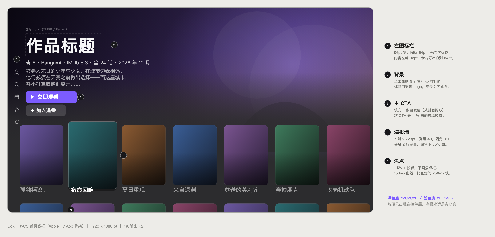
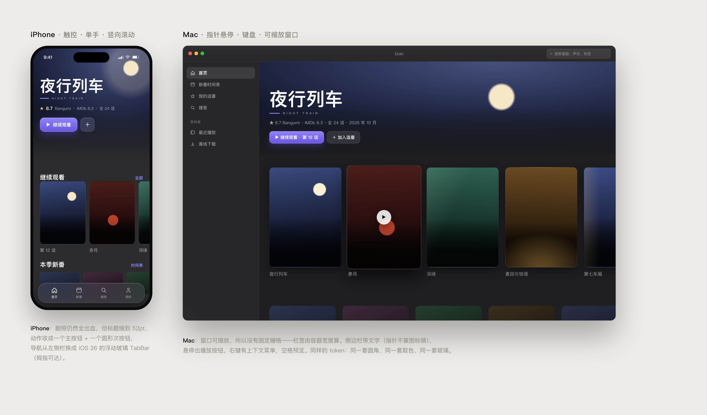

# Doki — Mac / iPhone / Apple TV 三端追番客户端设计方案

> **历史版本**：实施依据已更新为 [v0.4](Doki-设计方案-v0.4.md)。本文件保留早期探索，其中的接口示例、平台结论、范围和工期不再作为开发承诺。

> 版本 v0.2 ｜ 2026-10-29 ｜ 目标平台：iOS 27（最低 26）、tvOS 27（最低 26）、macOS 27（最低 26）
> **v0.2 变更**：拆解 Animeko 与 izuko-tv 后重写了三块——§4 源模型（改为按条目查询 + 浏览/自动匹配分层）、§5 tvOS 骨架（从 Netflix 改成 Apple TV App，数值换成实测值）、新增 §13 参考实现拆解与许可证说明。
> 本方案中的平台结论均已在本机 Xcode 27.1 / iOS 27.1 SDK / tvOS 27.0 SDK / Swift 6.4 上核对，Bangumi 接口以线上 `dist.json` 为准。仍属假设的部分在 M0 用 spike 验证（见附录 A）。

---

## 0. 一页结论

先说三个判断，它们决定了后面所有设计：

**① 真正的工程量不在 UI，而在「对齐」和「流」。**
Netflix 式的货架首页大概两周能做出八成像；而「Bangumi 条目/章节 ↔ TMDB 季/集 ↔ 源站的『第N集/S01E03/EP03』」的大规模对齐，以及「m3u8 代理在多设备并发下不崩」，才是决定这个产品能不能天天用的东西。方案里这两块是独立子系统，不是播放器的一个 if 分支。

**② Apple TV 逼着你必须做一个服务端。**
tvOS SDK 里**根本没有 WebKit.framework**（已核实）。也就是说，任何需要"打开网页 → 执行 JS → 嗅探出真实播放地址"的解析，在 Apple TV 上物理不可能。既然必须在服务端做，就顺势把三端都做成瘦客户端：客户端只负责「展示 + 播放 + 上报」，解析、缓存、对齐、字幕转换全在 Ubuntu 上。这反而让三端代码量大幅下降。

**③ 元数据用 Bangumi 做骨、TMDB 做皮，IMDb 只借 ID 和评分。**
IMDb 没有面向个人开发者的公开 API（只有面向研究的 TSV 数据集和一堆第三方转售 API，直接爬违反其 ToS，且图片有防盗链）。你要的"大横幅"实际来自 TMDB 的 `backdrop` + 透明 `logo`，它和 IMDb 共用 ID 体系，`/find?external_source=imdb_id` 就能互转。所以：**Bangumi 出中文标题/章节/收藏/评分，TMDB 出横幅/剧照/透明 Logo，IMDb 评分用 OMDb 补一个数字**。这个组合既合法又便宜（都免费）。

外加一条必须提前想清楚的：**这类应用进 App Store 的概率很低**（Guideline 5.2.3 明确禁止协助获取侵权内容）。方案给「双轨发布」：一条合规线（纯播放器 + 用户自备源），一条自用线（自签/TestFlight）。这个选择会反向影响产品形态，见 §11。

最后，§13 拆解了你给的两个开源项目（Animeko / izuko-tv）：借哪个数据模型、借哪些 UI 数值、为什么它们的代码一行都不能抄。**建议先读那一节**，它解释了本方案里一半的取舍。

---

## 1. 需求拆解与硬约束

### 1.1 需求清单

| # | 需求 | 归属 | 难度 |
|---|---|---|---|
| R1 | 三端原生，最新 iOS，Liquid Glass | 客户端 | 中 |
| R2 | 接入 Bangumi：登录、收藏、章节、评分、日历 | 服务端 + 客户端 | 中 |
| R3 | 接入 IMDb/TMDB：大横幅、Logo、剧照 | 服务端 | 低 |
| R4 | 线上播放源搜索 → 解析 → 播放 | 服务端（解析）+ 客户端（播放） | **高** |
| R5 | Netflix TV 端风格界面 | tvOS 为主 | 中 |
| R6 | Ubuntu 家用服务器 + WireGuard | 基础设施 | 中 |
| R7 | 跨端进度同步、追番日历、离线 | 服务端 + 客户端 | 中 |

### 1.2 平台事实核查（已在本机 SDK 验证）

| 事实 | 证据 | 对设计的直接影响 |
|---|---|---|
| `glassEffect(_:in:)` 从 iOS 26 / macOS 26 / **tvOS 26** / watchOS 26 起可用，`visionOS` 不可用 | SwiftUICore swiftinterface `@available(iOS 26.0, macOS 26.0, tvOS 26.0, watchOS 26.0, *)` | 三端可以共用同一套玻璃修饰符，**Apple TV 也能用真玻璃**，不必做 tvOS 降级分支 |
| `Glass` 支持 `.regular` / `.clear` / `.identity`，可 `.tint()`、`.interactive()` | 同上 `public struct Glass` | 可做低对比度背景下的 `clear` 变体、可交互高光 |
| `GlassEffectContainer` / `glassEffectID` / `glassEffectTransition` 三端可用 | SwiftUICore | 可以做"控件聚合成一滴玻璃"的形变动画（iOS/macOS 上用于播放器 HUD 收起） |
| `.buttonStyle(.glass)` / `.glassProminent` 可用 | SwiftUI swiftinterface | 次 CTA 用 `glass`；`glassProminent` 留给面板/弹层里的强调操作 |
| `TabView.tabBarMinimizeBehavior(.onScrollDown)` | iOS 26+ | iPhone 首页下滑时 TabBar 收起，给海报让位 |
| `NavigationTransition.zoom(sourceID:in:)` + `matchedTransitionSource` | iOS/macOS 26+ | 海报 → 详情页的"生长"转场，Netflix 感的关键之一 |
| **tvOS SDK 无 WebKit.framework** | `ls AppleTVOS27.0.sdk/.../WebKit.framework` → 不存在 | **解析必须在服务端**；客户端不做任何 DOM/JS |
| `NEVPNManager` tvOS 17+ 存在，但家用自签应用拿不到 `packet-tunnel` entitlement | NetworkExtension 头文件 / entitlement 规则 | Apple TV **不要指望跑 WireGuard**；它待在家里走局域网即可 |
| Bangumi `access_token` 有效期 604800s（7 天），`refresh_token` 轮换 | 官方 How-to-Auth | **`client_secret` 绝不能进客户端**，必须服务端代换 token + 服务端定时刷新 |
| Bangumi 集数进度：`PATCH /v0/users/-/collections/{subject_id}/episodes`（批量）、`PUT /v0/users/-/collections/-/episodes/{episode_id}`（单集） | `dist.json` paths | 单集上报用 PUT，批量补录用 PATCH，别写反 |
| IMDb 无公开 API；TMDB 有 `/find` + `/tv/{id}/images` | — | 见 §3 |

### 1.3 不做什么（防止范围爆炸）

- 不做弹幕（需要中心化弹幕池 + 高性能渲染，是另一个产品）
- 不做 BT/PT 下载（版权与复杂度双高；用「自有库 provider」替代，见 §4.2）
- 不做转码农场（只在必要时 `-c copy` 重封装，不做重编码）
- 不做社交/评论（Bangumi 已有，跳转即可）
- 不做 Android/Windows（先把三端做透）

---

## 2. 总体架构

### 2.1 拓扑

```
  iPhone / Mac ──────── WireGuard (10.10.0.0/24) ────────┐
  Apple TV   ──────── LAN (192.168.1.0/24) ──────────────┤
                                                         ▼
        Ubuntu 24.04  ·  "Doki Hub"          不对公网开放，无公网端口
          ├─ Caddy :443                TLS / 反代 / 限流
          ├─ doki-api                  Fastify：鉴权 / 同步 / 元数据聚合
          ├─ doki-worker               Playwright 解析 · ffmpeg 转封装 · 回写队列
          ├─ Postgres + Redis          状态 / 缓存 / 任务队列
          └─ /var/cache/doki           remux 分片与图片缓存
                                                         │
                                                         │ 出站 HTTPS
                                                         ▼
             api.bgm.tv          api.themoviedb.org          各播放源站
             元数据 / 收藏         横幅 / Logo              搜索 / 解析
```

**关键点：Hub 不出公网。** 只有 WireGuard 网段和局域网能访问。这既是安全边界，也省掉一整套鉴权/防刷/防 CC 的工作量。代价是：iPhone 在蜂窝网络下必须连上 WireGuard 才能用（元数据可以本地缓存兜底，见 §6.4）。

Apple TV 永远在家 → 走 LAN，不受 VPN 影响。这是刻意的拓扑选择：**别让电视依赖手机的热点或隧道**。

### 2.2 三种链路，按代价排序

| 链路 | 何时用 | 客户端拿到的 URL | 带宽成本 |
|---|---|---|---|
| `direct` | 源站直链无需 Referer/Cookie，且 CDN 允许 | 源站原始 m3u8 | 0（不经服务器） |
| `relay` | 源站校验 Referer/UA/Cookie，或需要重写分片 | `https://hub/s/{token}/master.m3u8` | 全程过家宽上行 |
| `remux` | 源是 MPEG-TS + AC3、或 iOS 不吃的封装 | `https://hub/s/{token}/master.m3u8`（服务端转封装后） | 全程过上行 + CPU |

解析器先探测，能 `direct` 就 `direct`——这直接决定了你在外面看番会不会卡。家宽 100Mbps 上行大约能撑 3 路 1080p relay，4K 基本只能 1 路。

### 2.3 技术选型

| 层 | 选型 | 理由 |
|---|---|---|
| 客户端 | SwiftUI，单仓多 target，Swift 6 strict concurrency | Liquid Glass / 焦点引擎 / AVPlayer 都只有原生能吃满；React Native 在 tvOS 上等于放弃焦点系统 |
| 服务端 | Node 22 + TypeScript + Fastify + Zod + Drizzle | 解析器天然是 JS（Playwright 就在 Node 里），一套运行时省掉跨语言调试 |
| 抓取 | Playwright（Chromium）+ undici | 需要真浏览器处理加密/风控；undici 做流代理性能足够 |
| 队列 | BullMQ（Redis） | 搜索/解析/回写/预热都是后台任务，需要重试与并发控制 |
| 存储 | Postgres 16 + Redis 7 | 元数据/对齐/进度用 PG；热点缓存/锁/队列用 Redis |
| 媒体 | ffmpeg（仅 `-c copy`） | 只做重封装与字幕转换，不重编码 |
| 网关 | Caddy | 自动 TLS、反代、限流一行配置 |
| 隧道 | WireGuard（`wg-quick`）| 你已有；split tunnel 只放 10.10.0.0/24 + 192.168.1.0/24 |

> 备选：服务端也可以全 Go（流代理吞吐更好、单二进制部署更爽），但 provider 脚本要么退化到 goja（ES5.1，写现代 JS 会疼），要么额外起一个 Node 子进程。**一个人维护，就选一个运行时**——这是我的建议。

---

## 3. 元数据层

### 3.1 三个数据源的职责边界

| 数据 | 来源 | 说明 |
|---|---|---|
| 中文标题、别名、简介、标签 | Bangumi `/v0/subjects/{id}` | `name_cn` + `infobox` 里的别名，是搜索匹配的黄金数据 |
| 章节列表、放送日期、时长 | Bangumi `/v0/episodes?subject_id=` | 追番日历、进度回写的基准 |
| 收藏状态、评分、吐槽 | Bangumi 用户接口 | 唯一真源，客户端只读缓存 |
| 大横幅、剧照、透明 Logo、预告片 | TMDB `/tv/{id}/images` | `backdrop` 选 1920×1080，`logo` 选 `iso_639_1 in [zh, ja, en, null]` |
| IMDb ID / 评分 | TMDB `external_ids` / OMDb | 评分只显示数字徽章，不落库依赖 |
| 关联作品（续作/前作/同系列） | Bangumi `/v0/subjects/{id}/subjects` | 直接喂给「More like this」货架 |

图片规格（TMDB）：`w780` 用于货架，`w1280` 用于详情页头图，`original` 仅用于 Hero；`logo` 用 `original`（透明 PNG）。全部过 Hub 的图片代理做尺寸归一与磁盘缓存，避免客户端各自处理防盗链。

### 3.2 Bangumi 接入

**OAuth 走服务端代换（broker）**，因为 `client_secret` 不能下发，且 refresh_token 会轮换。

```
iPhone/Mac:  App ──ASWebAuthenticationSession──▶ bgm.tv/oauth/authorize?redirect_uri=doki://oauth/bgm
                  ◀── doki://oauth/bgm?code=xxx&state=yyy ──
             App ──POST /v1/auth/bgm/exchange {code,state}──▶ Hub
             Hub ──POST bgm.tv/oauth/access_token (client_secret)──▶ 存 token（加密）
                  ◀── {deviceToken} ──
tvOS:        电视显示 QR + 6 位码 ──▶ 手机 App 扫码 ──▶ 同样的 exchange ──▶ 发 deviceToken 给电视
```

tvOS 上 `ASWebAuthenticationSession` 虽然从 tvOS 16 起就有，但让用户拿遥控器输 Bangumi 密码是反人类设计。**统一走设备码**，顺便把"手机已登录，电视自动登录"做成卖点。

**缓存与限流**
- 元数据 TTL：条目详情 7d、章节 1d、日历 6h、用户收藏 5min、搜索 5min（负结果 10min）
- Hub 侧全局限速 ≤ 1 req/s 到 `api.bgm.tv`，带退避（429/5xx 指数退避 + 抖动）
- User-Agent 必须可识别：`Doki/0.1 (https://github.com/<you>/doki)`，这是 Bangumi 的硬要求
- 所有响应落 `raw jsonb`，方便日后改 schema 时回放

**写回（这是最容易做错的地方）**
- 单集进度：`PUT /v0/users/-/collections/-/episodes/{episode_id}` body `{"type": 2}`（2 = 看过）
- 批量补录：`PATCH /v0/users/-/collections/{subject_id}/episodes`，body 是 `{episode_id: type}` 的映射
- 收藏：`PATCH /v0/users/-/collections/{subject_id}`，`{type, rate, ep_status, comment, tags, private}`，字段全可选
- **幂等**：所有写操作进 `outbox` 表，带去重键（`user+ep+type`），失败指数退避，最多重试 8 次后进死信并在 UI 上提示「同步失败」

### 3.3 三方 ID 对齐（核心子系统之一）

```
Bangumi 条目 (subject, type=2, eps=12, date=2024-04)
        │
        ├─① infobox 里有 IMDb/TMDB 链接？→ 直接用
        ├─② TMDB /search/tv?query=name_cn&language=zh-CN&year=2024
        │     再用 name(日文) 搜一次，合并候选
        ├─③ 打分：标题相似度 0.45 + 年份 0.2 + 集数 0.15 + 语言 0.1 + 海报感知哈希 0.1
        └─④ score ≥ 0.75 自动绑定；0.55~0.75 标灰待确认；< 0.55 交给人工
```

**"季"的坑**：Bangumi 一个条目通常 = 一个 cour（12/13 集），而 TMDB 常把两季合成一个 show 的 S1/S2，也有反过来把 24 集拆两季的。所以映射不能只存 `tmdb_id`，必须存 `(tmdb_id, season, episode_offset, rule)`：

| 场景 | 规则 |
|---|---|
| 一一对应 | `rule=direct`, `season=S`, `offset=0` |
| Bangumi 24 集 ↔ TMDB S1+S2 | `rule=split`, `season=1`, `splitAt=12` |
| Bangumi 从第 13 集开始的续作 ↔ TMDB S2 | `rule=season`, `season=2` |
| TMDB 集数多出总集篇/OVA | `rule=filter`, 按 airdate 对齐 |
| 实在对不上 | `rule=manual` + 人工在后台点两下 |

**章节 ↔ 源站集数**是另一个维度：源站可能是「第05集」「EP05」「[05]」「S01E05」，也可能是纯播放列表顺序。解析时统一抽 `episodeIndex`，优先级：显式季集号 > 中文"第N集/话" > 方括号数字 > 列表序号。抽不出来就按列表序号，并降置信度。

> 建议把这个映射做成**可修正的**：详情页里长按某一集 → 「这一集对应的源不对」→ 手动指定。数据攒起来后，对齐准确率会从 80% 爬到 97%，这是长期护城河。

### 3.4 领域模型（Swift 侧共享）

```swift
public struct Subject: Identifiable, Hashable, Sendable {
    public let id: Int                 // bgm subject id
    public let title: String           // name_cn，空则退回 name
    public let originalTitle: String
    public let year: Int?
    public let episodeCount: Int
    public let summary: String
    public let score: Double?
    public let rank: Int?
    public let tags: [String]
    public let posterURL: URL?
    public let backdropURL: URL?       // 来自 TMDB
    public let logoURL: URL?           // 透明 logo，Hero 用
    public let imdbID: String?
    public let imdbRating: Double?
    public let collection: CollectionState?
    public let airWeekday: Int?        // 1...7
}

public struct Episode: Identifiable, Hashable, Sendable {
    public let id: Int                 // bgm episode id
    public let subjectID: Int
    public let sort: Double
    public let title: String
    public let airdate: Date?
    public let duration: Duration?
    public let kind: Kind              // .main / .special / .op / .ed
    public var watched: Bool
    public var progress: PlaybackProgress?
}
```

---

## 4. 播放源子系统

### 4.1 为什么必须是服务端

| 需求 | 客户端能做吗 | 结论 |
|---|---|---|
| 打开源站页面、执行 JS、嗅探 m3u8 | iOS/macOS 可以（WKWebView），**tvOS 不行（无 WebKit）** | 服务端 |
| 给每个分片带 `Referer`/`Cookie` | AVPlayer 无法对 HLS 分片逐个设 header | 服务端代理 |
| 绕过 Cloudflare/JS 挑战 | 客户端做会被杀，且耗电 | 服务端 |
| 统一缓存、统一测速、统一健康度 | 三端各做一遍等于三倍 bug | 服务端 |

### 4.2 Provider 协议（插件化，不是写死）

不要自己发明源格式。Animeko 已经把它迭代了两年、有完整的文档和订阅仓库，直接对齐它的 `MediaSource` 模型能省掉半年的试错（许可证约束见 §13：**照模型实现，不抄代码**）。

它的三个设计决定值得原样照搬：

**① 查询以「条目」为单位，不以「集」为单位。**

```ts
interface MediaSource {
  // 返回该条目在本源能拿到的全部资源：每集的单集资源、每条线路、合集
  fetch(subject: SubjectRef): Promise<Media[]>   // 不按当前集裁剪
  browse?(keyword: string): Promise<BrowseSubject[]>  // 手动查找用
}

interface Media {
  mediaId: string          // 跨查询稳定：下载去重、线路记忆都靠它
  episodeRange: Range      // 这条资源覆盖第几集到第几集，合集就是 [1, 12]
  channel?: string         // 线路：字幕组 / 语言 / 画质
  kind: 'hls' | 'mp4' | 'magnet' | 'file'
  url: string
  headers?: Record<string, string>
}
```

按集搜的话，切一集就要搜一次站、解析一次页面；按条目搜，**整季只搜一次**，切集只是换个 `mediaId`。这是首帧能不能做到 1 秒的分水岭。

**② 浏览是第一等公民，自动匹配是可选的第二层。**

- 列表规则只负责"把站点上的东西列出来"：搜索结果 → 条目页 → 线路列表 / 剧集列表 → 播放页 → 视频地址。
- 自动匹配再叠一层：名称过滤、集号正则、线路 tier。

把两者拆开的原因很实际：OVA、SP、总集篇、剧场版天生没有"第几集"，自动匹配再聪明也对不上，必须留一条手动选的路。这条手动路径在电视上尤其重要——它是唯一能救回"自动匹配全错"的兜底。

**③ 订阅文件可以直接吃 animeko-subs 的格式。**

```json
{
  "id": "acg.example",
  "factoryId": "web-selector",
  "version": 2,
  "clientVersions": ">=6.3.0",
  "arguments": {
    "name": "示例源",
    "iconUrl": "https://...",
    "searchConfig": {
      "searchUrl": "https://.../search?wd={keyword}",
      "requestInterval": 3000,
      "subjectFormatId": "json-path-indexed",
      "selectorSubjectFormatJsonPathIndexed": { "...": "..." }
    },
    "tier": 0,
    "channelTiers": { "简中": 0, "繁中": 1, "杜比": 6 }
  }
}
```

`channelTiers` 是这份格式里最被低估的东西：它给线路（字幕组 / 语言 / 画质）排了序，`简中 = 0` 优先、`杜比 = 6` 垫底。我们的自动选源直接用它的排序，不用自己猜"哪个字幕组好"。

四种实现（全部跑在服务端）：

| 类型 | 形态 | 典型来源 |
|---|---|---|
| `selector` | CSS 选择器 + 正则，抓 HTML | 大多数站点 |
| `json-api` | 请求模板（含 `{var}` 代入）+ JSONPath | SPA 站点，HTML 里没数据 |
| `rss` | RSS/Atom → 磁力/直链 | 动漫花园、蜜柑计划 |
| `library` | WebDAV / Emby / Jellyfin | 自有库（合规线的核心） |

**执行细节**：`selector` 用 Playwright 取 DOM 后跑选择器，`json-api` 用 undici 发模板请求 + JSONPath。两者都要套 `requestInterval` 节流——源站按 IP 限流，一季 12 集连发必然 403。再加 5% 的"怪源"用沙箱 JS 兜底（QuickJS，8s 超时，域名白名单），别让 95% 的常规源陪它一起复杂。

**为什么必须服务端执行**：tvOS 没有 WebKit，客户端连 DOM 都没有；而且 `requestInterval`、缓存、关键词链这些状态天生属于服务端。客户端只拿最终的 `Media[]`。

### 4.3 自动匹配与线路选择

三步，每一步都要留人工兜底。

**第一步：名称过滤。**
用中文名、日文原名、罗马字各搜一次；都对不上时按"带季度标记的别名 → 由系列关系推出的基础名"回退。这里有个反直觉的坑：站点给续作起名往往以第一季为基础（「出包王女 第二季」），而 Bangumi 用官方译名（「更多 出包王女」），**只用官方名去搜必然零结果**。所以关键词链要按顺序试，并且把"这个关键词搜到过条目页"记进缓存——下次先试搜到过的，没搜到的不再浪费请求。

归一化规则：繁→简、全角→半角、去「第 N 季 / Season N / 第 N 期」、去掉年份后缀。

**第二步：集号对齐。**
优先级：`SxxExx` > 「第 N 集 / 话 / 話」> 方括号数字 > 列表序号。抽不出来就按列表序号并降置信度。合集资源的 `episodeRange` 是 `[1, N]`，单集是 `[n, n]`，两者要能共存——不然"合集"和"第 3 集"会打架。

**第三步：线路排序。**

```ts
rank = 0.40 * (1 - normalizedChannelTier)   // 来自订阅文件的 channelTiers
     + 0.20 * episodeConfidence             // 集号是解析出来的还是猜的
     + 0.15 * qualityScore                  // 1080p > 720p > 4K（家宽不够时降权）
     + 0.15 * providerHealth                // 滚动成功率
     + 0.10 * lastUsedBonus                 // 上次这条线路成功过
```

`channelTiers` 让"简中优先、杜比垫底"变成数据而不是代码，用户改订阅文件就能调排序。

**缓存**：源查询结果按 `(subjectId, providerId, keywordSet)` 存，TTL 6 小时；条目详情页打开时就后台预热（BullMQ 低优先级），点播放时命中率能到 85%+。切集不重新查询——只换 `mediaId`。

### 4.4 播放计划

```json
{
  "episodeId": 1024,
  "subjectId": 253,
  "title": "第 5 话 你叫什么名字",
  "resumeAt": 312.5,
  "sources": [
    { "id": "st_9f3", "mode": "relay",  "url": "https://hub.home/s/st_9f3/master.m3u8",
      "mediaId": "girigiri:1123:3", "channel": "简中", "quality": "1080p",
      "episodeRange": [3, 3], "provider": "acg.example", "ttfbMs": 420 },
    { "id": "st_2b1", "mode": "direct", "url": "https://cdn.example/x/index.m3u8",
      "mediaId": "b:7781:0", "channel": "繁中", "quality": "720p",
      "episodeRange": [1, 12], "provider": "b.example", "ttfbMs": 180 }
  ],
  "subtitles": [
    { "lang": "zh-Hans", "label": "简中", "url": "https://hub.home/s/sub_88/zh.vtt", "format": "vtt" }
  ],
  "next": { "episodeId": 1025 }
}
```

客户端**按顺序尝试**，首个分片 TTFB > 2.5s 或 `AVPlayerItem.status == .failed` 就换下一个，最多 3 个。切换时保留播放位置，用户无感。

**一次点播的完整时序**（实现时照着这条链排查最快）：

```
1. tvOS 焦点落在「第 5 话」 → 点击
2. GET /v1/episodes/1024/play
3. Hub: 命中该条目的源结果（整季）？
   ├─ 是 → 直接挑线路并解析（~300ms）
   └─ 否 → 投递低优任务，返回 202 + 任务 id，客户端显示"正在寻找片源"
4. resolve 产出 stream（Playwright 3~8s），写 Redis，签 token
5. 返回 PlaybackPlan（≤3 个源，按健康度排序）
6. 客户端 AVPlayer 起播；同时上报 play_start（用于统计源质量）
7. 播放中每 5s 本地落盘，每 15s 批量上报
8. 播放到 80% 时预解析「下一集」，实现无缝连播
9. 进度 ≥ 90% → outbox → Bangumi PUT 单集已看
```

第 3 步的"有缓存直接给"很关键：**用户第二次点同一集，绝不能再等 8 秒**。

### 4.5 流代理（最容易踩坑的地方）

**签名**：`/s/{streamId}/{path}?sig=<HMAC(secret, streamId+exp)>`，TTL 6h，绑定设备。

**m3u8 重写**：
```
#EXTM3U
#EXT-X-KEY:METHOD=AES-128,URI="https://hub/s/st_9f3/key/0?sig=..."   ← 改写
#EXT-X-MAP:URI="https://hub/s/st_9f3/init/0.mp4?sig=..."             ← 改写
#EXTINF:9.009,
https://hub/s/st_9f3/seg/0.ts?sig=...                                 ← 改写
```
- token → upstream 的映射存 Redis（`streamId → {baseURL, headers, providerId}`），分片路径只在内存里拼接，**不落库**
- 支持 Range 透传（有些源用 byte-range 的多段 m3u8）
- `Content-Type` 归一化（源站经常把 m3u8 返回成 `text/plain`，AVPlayer 会拒播）
- 并发：单流最多 4 个分片并行，全局连接池按 provider 隔离，避免一个坏源拖垮全部

**重封装兜底**：当探测到 `MPEG-TS + AC3`（iOS/tvOS 不吃 AC3 于 HLS 的情况）或 `H.264 + MP3` 时，`ffmpeg -i <upstream> -c copy -f hls -hls_time 6 -hls_playlist_type event` 落盘到 `/var/cache/doki/remux/{streamId}`，边转边播。**只 copy 不重编码**，CPU 占用约 2~5%，一台 N100 也能扛 3 路。

**健康度**：每个 provider 记 `success/fail`、`ttfb_p50`、`stall_count`，滚动窗口 200 次。低于 0.6 自动降权，低于 0.3 自动禁用并发企业微信/Telegram 通知你（可选）。

### 4.6 字幕

| 输入 | 处理 | 输出 |
|---|---|---|
| `.vtt` / `.srt` | 直接转 VTT，编码统一 UTF-8 | 内嵌 or 外挂 |
| `.ass`（字幕组特效） | 服务端 `ffmpeg -i in.ass out.vtt`，保留对白与基础样式，丢特效 | 外挂 VTT |
| 需要特效 | 可选：`-vf subtitles=in.ass` 烧录（**只在用户显式开启时**，且只对单集） | 硬字幕 |
| 源内嵌字幕 | 用 `AVPlayerItem` 的 legible 轨道 | 原生 |

客户端渲染用**自绘 overlay**（`AVPlayerViewController.contentOverlayView` 里放 `CATextLayer` / CoreText），而不是依赖 `AVPlayerItemLegibleOutput`——理由：只有自绘才能控制字幕位置/描边/字号，且三端一致。代价：AirPlay / 画中画时 overlay 不跟随（这是已知取舍，接受）。

### 4.7 播放器实现

```swift
// 统一播放控制：三端一份，平台差异用 #if
@MainActor
final class PlaybackController: ObservableObject {
    private let player = AVPlayer()
    private var candidates: [PlaybackSource]
    private var currentIndex = 0
    private var timeObserver: Any?

    func start(plan: PlaybackPlan) async {
        candidates = plan.sources
        await tryPlay(at: 0, resumeAt: plan.resumeAt)
        timeObserver = player.addPeriodicTimeObserver(
            forInterval: CMTime(seconds: 5, preferredTimescale: 600), queue: .main
        ) { [weak self] t in self?.report(t) }
    }

    private func tryPlay(at index: Int, resumeAt: Double) async {
        guard index < candidates.count else { return failoverExhausted() }
        let src = candidates[index]
        // 注意：不要用私有的 AVURLAssetHTTPHeaderFieldsKey，需要 header 就走 relay
        let asset = AVURLAsset(url: src.url)
        let item = AVPlayerItem(asset: asset)
        item.preferredForwardBufferDuration = 15
        player.replaceCurrentItem(with: item)
        player.seek(to: CMTime(seconds: resumeAt, preferredTimescale: 600))
        // 2.5s 内没起来就换源
        if await !waitForReady(item, timeout: .seconds(2.5)) {
            await tryPlay(at: index + 1, resumeAt: resumeAt)
        }
    }
}
```

平台差异：

| | iOS | tvOS | macOS |
|---|---|---|---|
| 容器 | `AVPlayerViewController`（inline ↔ fullscreen） | `AVPlayerViewController` | `AVPlayerView` |
| 控件 | 系统控件 + 自定义玻璃 HUD | **用系统传输条**（tvOS 26 已是 Liquid Glass），只加 `contentOverlayView` | 系统控件 + 菜单栏命令 |
| 手势/输入 | 双击左右快进、上下滑音量/亮度 | 焦点 + 遥控器（左右 10s、长按快进） | 键盘（空格、←→、↑↓、F） |
| 画中画 | `AVPictureInPictureController` | 不支持 | 支持 |
| 后台音频 | `AVAudioSession.playback` + `UIBackgroundModes: audio` | — | 支持 |
| Now Playing | `MPNowPlayingInfoCenter` + 远程命令 | — | `MPNowPlayingInfoCenter` |

**别忘了这两件事：**
1. `AVPlayerItem.externalMetadata` 塞标题/封面/简介，AirPlay 和锁屏才有东西显示。
2. tvOS 上 `AVDisplayManager` 开「匹配内容」才能输出 24p/HDR，否则会有 3:2 pulldown 的抖动。

### 4.8 离线下载

- 仅对 **非 DRM** 的 HLS 有效，用 `AVAssetDownloadURLSession` + `AVAssetDownloadConfiguration`
- 走 relay 的源，下载 URL 同样带签名，过期则续签（下载队列里存 `streamId` 而非完整 URL）
- 存储：`Library/Caches/Downloads`，`isExcludedFromBackup = true`
- 配额：默认 20GB，超了按「最近最少看」淘汰
- 版权提示：下载的文件仅本机可播，App 内不做导出/分享入口

---

## 5. 界面设计

### 5.1 设计原则：玻璃穿在控制层，不穿在内容上

Apple 自己的 HIG 说得很直白：Liquid Glass 属于**导航与控件层**，不属于内容。Netflix 的界面是纯平、纯黑、无 chrome 的——把海报做成毛玻璃会立刻变成"水果糖"，而且 tvOS 上每张卡都开玻璃会让 GPU 直接跪。

**玻璃预算：一个屏幕同时最多 3 层玻璃，且面积不超过屏幕 15%。**

设计 token（三端共用，写进 `DokiUI/Theme.swift`）：

| token | 深色 | 浅色 | 用途 |
|---|---|---|---|
| `page` | `#2C2C2E` | `#BFC4C7` | 页面底（不是纯黑/纯白，见 §5.3） |
| `surface` | `#1C1C1E` | `#FFFFFF` | 卡片、面板、列表行 |
| `textPrimary` | `#FFFFFF` @90% | `#000000` | 标题 |
| `textSecondary` | `#FFFFFF` @62% | `#000000` @60% | 元信息、副标题 |
| `accent` | **条目取色** | 同 | 主 CTA、进度条填充、焦点圆钮 |
| `glassFill` | `onSurface` @**10%** | 同 | 玻璃底，由 `glassEffect` 的 `tint` 给出 |
| `rPoster` / `rPill` | 16 / 32 | 同 | 圆角 |
| `shelfGap` / `rowGap` | 40 / 40 | 同 | 间距 |

**`accent` 不是品牌色**，是每部番从封面里提的：封面缩到 32×32 求主色 → 转 HSL → 把饱和度夹到 `0.45~0.70`、亮度夹到 `0.55~0.65`（保证在深色底上够亮、在浅色底上够深）。同一部番的海报在首页、详情页、播放器圆钮里是同一个色。

透明度不随手写，用一组固定阶梯（黄金分割比，视觉上等差感最好）：

```swift
enum Alpha { static let strong = 0.90; static let medium = 0.618
             static let base = 0.50;   static let weak = 0.382
             static let disabled = 0.12 }
```

> 不要用 `Material` + 自绘模糊去仿玻璃：一是不跟系统的折射/高光走，二是 tvOS 上自绘 blur 直接掉帧。只调 `glassEffect` 的 `tint` 与形状。

| 该用玻璃 | 不该用玻璃 |
|---|---|
| 顶部导航胶囊栏、TabBar | 海报卡、剧集卡 |
| 播放器 HUD、进度条、音量条 | 详情页背景 |
| 选集抽屉、设置面板、Toast | 列表行背景 |
| 悬浮的「继续观看」迷你条 | 任何需要读文字的密集区域 |

### 5.2 信息架构

```
iPhone                          Mac                            Apple TV
├─ 首页 (推荐/继续看)            ├─ 侧边栏：首页/新番/收藏/搜索   ├─ 左图标栏：探索/搜索/追番/时间表/设置
├─ 新番日历                     ├─ 内容区：网格/货架             ├─ 首页：Hero 态 + 海报墙/货架
├─ 搜索                         ├─ 右侧 Inspector：详情/选集      ├─ 详情：剧照 + Logo + 选集/评论
└─ 我的 (Bangumi 账号/设置)      └─ 菜单栏 + 设置窗口             └─ 播放器
```

### 5.3 tvOS：骨架不是 Netflix，是 Apple TV App

先纠正我自己：上一版按 Netflix 写了「玻璃胶囊顶栏 + 圆角 Hero 卡」。看过 izuko-tv 的实测截图和源码后，它的骨架其实更接近 **Apple TV App + Prime Video**——Netflix 的影子只剩「横向货架」和「自动预览」两件事。这两种骨架的差别是根子上的：

| | Netflix 骨架 | Apple TV App 骨架（izuko 走这条） |
|---|---|---|
| 导航 | 顶部横向 tab | **左侧图标栏**，无文字标签 |
| 背景 | 圆角 Hero 卡 | **全出血剧照 + 羽化边缘**，压到页面底下 |
| 标题 | 文字排版 | **透明 Logo 位图**，可以很大 |
| 容器 | 卡片有底色/描边 | **零容器**，只有圆角和投影 |
| 焦点 | 放大 + 白框 | **只放大 + 投影，不画框** |
| 主色 | 品牌红 | **条目取色**（从封面提） |

所以下面这张规格表是**实测值**，不是拍脑袋：izuko 的 Android TV 画布是 960×540 dp，tvOS 是 1920×1080 pt，**正好 ×2**，可以逐项换算。

| 元素 | izuko (dp @960) | tvOS (pt @1920) | 说明 |
|---|---|---|---|
| 内容左缘 | 48 | 96 | 与详情页文字左缘对齐 |
| 卡片左出血 | 16 | 32 | 卡片可以滑到图标栏下面 |
| 页尾内边距 | 48 | 96 | |
| 侧栏收起宽 | 48 | 96 | 图标 32dp→64pt，居中 |
| 海报卡基准宽 | 112 | 224 | 最小 118dp→236pt，列数按内容宽算 |
| 封面比例 | 0.72 (w/h) | 0.72 | 不是 2:3，更瘦 |
| 卡片圆角 | 8 | 16 | |
| 列距 / 行距 | 20 / 20 | 40 / 40 | 注释直接写了「Apple 规范 40pt」 |
| 组标题到卡片 | 18 | 36 | |
| 番名行高 | 18sp × 2 行定高 | 36pt | 定高防跳版 |
| 副标题 | 11.5sp | 23pt | 正好是 tvOS Caption 2 |
| 聚焦缩放 | 1.12（无框）/ 1.10（带框） | 同 | |
| 聚焦动画 | 150 ms | 同 | 比手感直觉的 250ms 快很多 |
| 焦点框（需要时） | 1.75 | 3.5 | 他们的注释：Prime Video 4K 截图实测 7px |
| 进度条 | 高 3 / 底距 2 / 轨道 30% 白 | 6 / 4 / 30% | 填充色 = 条目取色 |
| 圆钮直径 | 32 / 48 | 64 / 96 | 聚焦时填充主色 80% |
| Hero 按钮 | 圆角 8、描边 0.5、内边距 14/8、图标 20、整体 ×0.9 | 16 / 1 / 28/16 / 40 | |
| Hero 文字底 | 268 | 536 | 首屏下半留给货架 |
| Hero 态货架顶 | 310 | 620 | |
| 页面底色（深） | rgb(44,44,46) | `#2C2C2E` | Apple TV App 的实测底色 |
| 页面底色（浅） | `#BFC4C7` | 同 | 见下面的浅色主题 |

#### 效果预览


*1920×1080 pt 渲染，4K 输出。左图标栏与海报墙来自 izuko，按钮材质、徽章、圆角、字体与焦点态来自 Apple。*

「izuko 的骨架 + 苹果的皮肤」具体改了七处：

| izuko 原样 | 苹果化处理 | 理由 |
|---|---|---|
| 紫色实心 CTA | **Liquid Glass 染色胶囊**：blur 22 + 内侧 1px 高光 + 顶部渐层 | 玻璃是苹果的控件语言，染色保住"条目取色" |
| 灰底次按钮 | `.glass` 胶囊（blur 26 / 饱和 190%） | 与主按钮同一材质族，只差染色 |
| 8dp 圆角 | 16pt 连续圆角 | tvOS 的 squircle 观感 |
| 无徽章 | `4K / HDR / 全景声` 玻璃小徽章 | Apple TV App 的招牌信息层 |
| 纯文字番名 | SF Pro Display，字距 +1，96pt | 苹果的标题排版更紧、更满 |
| 只放大不画框 | **保留**：1.12 + 44px 投影 + 顶部 1px 高光 | tvOS 原生焦点就是这套，不该改 |
| 左图标栏 | **保留不动** | Apple TV App 用的是顶部 tab，这里刻意不跟——你要的是 izuko 的骨架 |

一句话：**骨架不苹果，材质和排版苹果。** 苹果的部分全部集中在"控件层"（按钮、徽章、焦点、字体、圆角），内容层（海报、剧照、番名）保持 izuko 的克制——这恰好也是 Liquid Glass 的设计约束（见 §5.1）。

线框版（标了尺寸，供实现对照）：



*① 左侧图标栏 ② 羽化背景 + 透明 Logo ③ 条目取色的主 CTA ④ 2 行定高的番名块 ⑤ 只放大不画框的焦点态。*

#### Hero 态：唯一值得多花两周的地方

izuko 的「hero 态」是整套 UI 里最贵的部分，也是最像 Apple TV 的地方：焦点落到某张卡上，整页背景换成那部番的剧照，标题浮上来，卡片淡下去。它的状态机值得照抄（参数是源码里的真实值）：

```
焦点落卡
  └─ 300ms 防抖（快速划卡不触发）
       ├─ 深色主题、未开模糊：整屏压黑 → 黑度 > 0.95 才让背景图淡入（防闪）
       ├─ 开了模糊背景：模糊层淡入 → 停稳后换成清晰图
       └─ 换内容时：按下即压暗，新内容到了再提亮（"按下即有反馈"）
按下确定
  ├─ 卡片淡没 + 整屏背景对焦变清晰
  ├─ 标题从 hero 样式切成详情页样式（浅色主题：黑字 → 白字压黑影）
  └─ 全部到位后才 push 详情页；返回时倒放
```

这套东西在 SwiftUI 里的近似实现：

```swift
// 背景层：羽化 + 压黑门槛
ZStack {
    Color.black.opacity(heroState.backdropOpacity)          // 先黑透
    AsyncImage(url: heroState.backdropURL) { $0.resizable().scaledToFill() }
        .opacity(heroState.contentAlpha)                     // 门开后淡入
        .blur(radius: settings.heroBlur ? 40 : 0)
        .overlay(LinearGradient(colors: [.clear, .black.opacity(0.75)], startPoint: .top, endPoint: .bottom))
}
.animation(.easeInOut(duration: 0.6), value: heroState.contentAlpha)
```

三个坑：
1. **压黑门槛**必须做。少了它，换图时会有一帧"半透明叠旧图"的闪。
2. **防抖 300ms** 必须做。遥控器连发时每次按键都换背景图，解码器会排队卡死。
3. **图要分级**：先出 `w780`，停稳 400ms 再换 `w1280`，否则每次换卡都卡一下。

#### 浅色主题不是"白色版深色"

izuko 的浅色主题是一次独立设计：页面底 `#BFC4C7`（不是白），卡片往白走，正文纯黑、次要文字黑 60%，海报的彩度反过来成了主角。电视上大片纯白会刺眼，所以**底色是灰的、面板是白的**。这条规则对三端都成立。

```swift
extension Color {
    static let pageDark  = Color(hex: 0x2C2C2E)
    static let pageLight = Color(hex: 0xBFC4C7)
    static let panelLight = Color.white
}
```

#### 焦点：只放大，不画框

```swift
struct PosterCard: View {
    let subject: Subject
    @Environment(\.colorScheme) private var scheme
    @FocusState private var focused: Bool

    var body: some View {
        VStack(alignment: .leading, spacing: 12) {
            AsyncImage(url: subject.posterURL) { $0.resizable().scaledToFill() }
                .frame(width: 224, height: 311)          // 224 / 0.72
                .clipShape(.rect(cornerRadius: 16))
            Text(subject.title)
                .font(.system(size: 36, weight: .regular))
                .lineLimit(2)
                .frame(height: 88, alignment: .top)      // 定高，换焦点不跳版
        }
        .scaleEffect(focused ? 1.12 : 1, anchor: .center)
        .shadow(color: .black.opacity(focused ? 0.45 : 0), radius: 28, y: 16)
        .animation(.easeOut(duration: 0.15), value: focused)
        .focusable()
        .focused($focused)
    }
}
```

> 两个反直觉的点：**150ms 不是 250ms**（快到像"贴手"），**不画焦点框**。加框是 Android TV 的习惯，Apple TV App 上根本没有；只有在"缩放表达不了焦点"的地方（文字行、列表项、圆钮）才用 1.75dp→3.5pt 的描边。

#### 播放器 chrome 做成可配置

izuko 的播放控制层是一行**圆钮**（跳过 90s、下一集、选集、字幕、音轨、倍速、画面比例、弹幕、下载……），中间夹分组竖线和弹性留白，顺序**用户可改**。这个设计对番剧特别合适——每个人要的按钮不一样，而 tvOS 的遥控器又只有那么几个键。

我们的版本定 6 个固定 + 4 个可选，不做无限自定义（维护成本）：

`[跳过 OP 90s] [下一集] ── [选集] [字幕] [音轨] ── [倍速] [画面比例] [源切换]* [弹幕]*`

#### Top Shelf

可选加分项：做一个 `TVServices` 扩展，把「继续观看」推到 Apple TV 主屏。成本约 1 天，但「打开电视就接着上次的位置继续看」很值。

### 5.4 iPhone 与 Mac：同一套皮肤，不同的骨架



三端不是"把 TV 界面缩小"，而是三个输入模型各写一层壳。先分清什么能共享：

| 层 | 共享？ | 说明 |
|---|---|---|
| 设计 token（颜色 / 圆角 / 透明度阶梯 / 取色算法） | ✅ 100% | 一份 `Theme.swift` |
| 组件（海报卡、徽章、玻璃按钮、进度条） | ✅ 参数化 | 尺寸由外部传入，不写死 |
| 数据 / 播放 / 缓存 / 同步 | ✅ 100% | 全在 `Packages/` 里 |
| 布局与导航 | ❌ 各写一套 | 见下表 |
| 动效 | ⚠️ 部分 | 时长与曲线共享，「聚焦放大」只有 tvOS 有 |

三个输入模型决定了三套骨架：

| | Apple TV（遥控器焦点） | iPhone（手指，无 hover） | Mac（指针 + 键盘） |
|---|---|---|---|
| 导航 | 左侧图标栏，常驻、可聚焦 | 底部浮动玻璃 TabBar（拇指区） | 侧边栏，带文字、可折叠 |
| 栅格 | 固定 1920×1080，7 列 | 390pt 宽，竖滚 + 横滑露 2.5 张 | 窗口任意宽，列数按容器算 |
| 标题 | 96pt 透明 Logo 位图 | 52pt 文字标题，最多两行 | 60pt，随窗口缩放 |
| 动作 | 2 个并排（主 CTA + 次 CTA） | 1 主按钮 + 1 圆钮 | 2 个并排 + 右键上下文菜单 |
| 焦点 / 悬停 | 1.12 缩放 + 投影 | 无焦点，只有按压态 | 1.035 缩放 + 播放入口浮现 |
| 玻璃位置 | 圆钮、徽章、播放器 HUD | TabBar、动作按钮 | 侧边栏、工具栏（系统材质） |
| 安全区 | 电视 overscan 60pt | 底部 34pt + 灵动岛 | 标题栏 52pt |
| 自动预览 | 焦点停留 600ms 播放 | **关掉**（流量/电量） | 悬停 800ms 静音播放 |

五条硬规则：

1. **字号不共享，比例共享。** TV 的 36pt 番名搬到 iPhone 是灾难；要共享的是"番名 : 副标题 = 18 : 11.5"这个比例关系。
2. **iPhone 没有焦点。** 所有依赖 focus 的动效（放大、预览、高光）必须重做成按压态，别指望 `hoverEffect` 能还原。
3. **Mac 没有固定栅格。** 列数必须 `floor((width - padding) / minCardWidth)`，否则窗口一缩就爆版。
4. **Mac 的玻璃由系统给。** 侧边栏 vibrancy、工具栏材质都是系统注入的，自己再叠 `glassEffect` 会打架——这也是为什么 Mac 上"玻璃预算"反而要更严。
5. **iPhone 的详情页靠转场建立空间感**（`matchedTransitionSource` + `.zoom`），TV 靠 hero 态，Mac 靠多窗口和 Inspector。三者解决的是同一个问题："我从哪来的，能回到哪去"。

一句话：**TV 是"被设计的"，iPhone 是"被握住的"，Mac 是"被操作的"。同一个世界观，三种身体。**

其余平台细节：

- **iPhone**：`.tabBarMinimizeBehavior(.onScrollDown)` 下滑收起 TabBar；播放竖屏 inline、横屏全屏；锁屏/灵动岛显示进度；搜索用 `.searchable` + Bangumi 建议（防抖 300ms）。
- **Mac**：`.windowStyle(.hiddenTitleBar)`，内容延伸到标题栏下；空格播放、←→ 10s、⌘F 搜索、`⌘,` 设置；`WindowGroup(for: Subject.ID.self)` 支持多窗口；PiP + 菜单栏「正在播放」可选。

### 5.6 玻璃代码范式（三端共用）

```swift
/// 统一的玻璃容器：iOS/macOS 做形变聚合，tvOS 先用单层
struct GlassCluster<Content: View>: View {
    var spacing: CGFloat = 12
    @ViewBuilder var content: Content

    var body: some View {
        #if os(tvOS)
        content                      // tvOS: 先不做 union，M4 压测后再决定要不要开
        #else
        GlassEffectContainer(spacing: spacing) { content }
        #endif
    }
}

/// 播放器 HUD
struct PlayerHUD: View {
    var body: some View {
        GlassCluster(spacing: 14) {
            Button("上一集") {}.buttonStyle(.glass)
            Button("下一集") {}.buttonStyle(.glass)
            Button("选集")   {}.buttonStyle(.glassProminent)
        }
        .padding(14)
    }
}
```

### 5.7 性能预算

| 指标 | 目标 | 手段 |
|---|---|---|
| 冷启动到首屏 | < 1.2s（有缓存）/ < 2.5s（无） | SwiftData 预热 + 图片磁盘缓存 + 骨架屏 |
| 货架滚动 | 稳定 60fps | `LazyHStack` + 图片解码降采样 + 预取 8 张 |
| 内存（tvOS） | < 300MB | 图片缓存上限 120MB，其余 LRU 淘汰 |
| 首帧时间 | < 1.5s（候选池命中） | 预解析下一集 + 预热连接 |
| 包体 | < 40MB | 无第三方大库；图片全走网络 |

---

## 6. 同步

### 6.1 进度

- 本地 **SwiftData 为即时真源**：每次暂停/退出/每 15s 落一次本地
- 上报：`POST /v1/progress`，批量、幂等（`(deviceId, episodeId, position, clientTs)`）
- 服务端合并：`serverSeq` 单调递增；同集冲突时取 `position` 较大者，但若 `|Δts| > 5min` 且 `position` 差异 > 60s，则以「最近播放的那台设备」为准
- 拉取：`GET /v1/sync?since={seq}`，返回变更集（进度、收藏、订阅源）

### 6.2 Bangumi 回写

- 触发条件：进度 ≥ 90% 或用户手动标记
- 走 `outbox`，失败重试，UI 上有「待同步 N 条」的角标
- `rate`/`comment` 只在用户显式操作时写，**绝不自动评分**

### 6.3 离线

- 元数据：最近 30 天看过的条目全量缓存
- 播放：下载队列（§4.8）
- 弱网：`HubAvailability` 状态机 `lan → tunnel → offline`，offline 时首页降级为「我的下载 + 缓存」

### 6.4 隧道不可用时的降级

用户在外面没开 WireGuard 是常态。客户端要能：
1. 秒开（缓存首页）
2. 明确提示「未连接家庭网络」+ 一键跳转 WireGuard App
3. 不把失败重试刷成红色报错墙

---

## 7. 服务端工程

### 7.1 目录

```
server/
├─ src/
│  ├─ api/            # 路由、鉴权、SSE
│  ├─ domain/         # subject/episode/alignment/progress
│  ├─ providers/      # scraper/m3u/webdav/emby + 沙箱
│  ├─ stream/         # m3u8 重写、转发、remux
│  ├─ jobs/           # BullMQ 队列定义与 worker
│  ├─ integrations/   # bgm, tmdb, omdb
│  └─ db/             # drizzle schema + migrations
├─ deploy/
│  ├─ docker-compose.yml
│  ├─ Caddyfile
│  └─ wg0.conf.example
└─ test/fixtures/     # 录制下来的 HTML/JSON，做契约测试
```

### 7.2 API 契约

| Method | Path | 说明 |
|---|---|---|
| GET | `/v1/bootstrap` | 启动配置、能力开关、Hub 版本 |
| GET | `/v1/home` | 货架（继续观看/本季新番/高分/相关系列） |
| GET | `/v1/calendar` | 本周放送 |
| GET | `/v1/subjects/{id}` | 聚合详情（bgm + tmdb） |
| GET | `/v1/subjects/{id}/episodes` | 章节 + 观看状态 |
| POST | `/v1/search` | `{q, type}` |
| POST | `/v1/subjects/{id}/sources:search` | 触发源搜索（异步任务） |
| GET | `/v1/episodes/{id}/play` | `PlaybackPlan` |
| GET | `/s/{streamId}/…` | 流代理（签名） |
| POST | `/v1/progress` | 批量进度 |
| GET | `/v1/sync?since=` | 增量同步 |
| POST | `/v1/auth/bgm/start` `/exchange` | OAuth broker |
| POST | `/v1/devices/pair` `/claim` | 电视配对 |
| GET | `/v1/admin/alignments` | 待确认的对齐（网页后台） |

约定：全部 JSON、`snake_case` 不用（统一 `camelCase`）、错误体 `{code, message, retryable}`、时间戳一律 ISO8601 UTC。

### 7.3 数据库

```sql
create table subject (
  bgm_id     int primary key,
  type       smallint not null,
  name       text not null,
  name_cn    text not null default '',
  year       smallint,
  eps        smallint,
  summary    text,
  cover_url  text,
  score      numeric(3,1),
  rank       int,
  tags       jsonb not null default '[]',
  infobox    jsonb not null default '[]',
  raw        jsonb not null,
  fetched_at timestamptz not null default now()
);

create table subject_external (
  bgm_id     int references subject(bgm_id) on delete cascade,
  provider   text not null,                 -- tmdb | imdb | tvdb | fanart
  ext_id     text not null,
  season     smallint,
  ep_offset  smallint not null default 0,   -- 集号偏移，处理 split cour
  rule       text,                          -- direct | split | season | filter | manual
  confidence real not null default 0,
  verified   boolean not null default false, -- 人工确认过
  primary key (bgm_id, provider)
);

create table episode (
  bgm_ep_id int primary key,
  bgm_id    int references subject(bgm_id) on delete cascade,
  kind      smallint not null,              -- 0本篇 1SP 2OP 3ED
  sort      numeric(6,2) not null,
  name      text, name_cn text,
  airdate   date,
  duration  text
);

create table episode_alignment (
  bgm_ep_id  int primary key references episode(bgm_ep_id) on delete cascade,
  season     smallint,
  episode    smallint,
  rule       text,                          -- direct | split | season | filter | manual
  confidence real
);

create table provider (
  id       text primary key,
  name     text not null,
  kind     text not null check (kind in ('scraper','m3u','webdav','emby')),
  manifest jsonb,
  enabled  boolean not null default true,
  health   real not null default 1
);

create table candidate (
  id          bigserial primary key,
  bgm_id      int references subject(bgm_id) on delete cascade,
  provider_id text references provider(id) on delete cascade,
  title       text, href text, quality text, subgroup text, lang text,
  score       real,
  first_seen  timestamptz default now(),
  last_ok     timestamptz
);

create table stream (
  id           text primary key,
  candidate_id bigint references candidate(id) on delete cascade,
  bgm_ep_id    int references episode(bgm_ep_id),
  kind         text,                        -- hls | mp4
  url          text,
  headers      jsonb,
  expires_at   timestamptz,
  created_at   timestamptz default now()
);

create table progress (
  user_id    uuid, bgm_ep_id int, position int, duration int,
  completed  boolean default false,
  updated_at timestamptz, device_id text,
  primary key (user_id, bgm_ep_id)
);

create table outbox (
  id       bigserial primary key,
  user_id  uuid, op text, payload jsonb,
  attempts int default 0,
  next_at  timestamptz default now(),
  done     boolean default false
);
```

### 7.4 部署

```yaml
# deploy/docker-compose.yml
services:
  caddy:
    image: caddy:2
    ports: ["443:443"]
    volumes:
      - ./Caddyfile:/etc/caddy/Caddyfile:ro
      - caddy_data:/data
    depends_on: [api]

  api:
    build: { context: .., dockerfile: Dockerfile }
    environment:
      DATABASE_URL: postgres://doki:***@db:5432/doki
      REDIS_URL: redis://redis:6379
      BGM_CLIENT_SECRET: ${BGM_CLIENT_SECRET}
      TMDB_API_KEY: ${TMDB_API_KEY}
      STREAM_SIGNING_KEY: ${STREAM_SIGNING_KEY}
    volumes: [/var/cache/doki:/var/cache/doki]
    depends_on: [db, redis]

  worker:
    build: { context: .., dockerfile: Dockerfile.worker }   # 含 chromium + ffmpeg
    environment: { DATABASE_URL: ..., REDIS_URL: ... }
    shm_size: 1gb
    volumes: [/var/cache/doki:/var/cache/doki]

  db:
    image: postgres:16
    volumes: [pgdata:/var/lib/postgresql/data]
    environment: { POSTGRES_DB: doki, POSTGRES_USER: doki, POSTGRES_PASSWORD: *** }

  redis:
    image: redis:7-alpine
    command: redis-server --appendonly yes
```

Caddyfile：

```
hub.home.arpa {
    tls internal
    encode zstd gzip
    reverse_proxy /v1/* api:8080
    reverse_proxy /s/*  api:8080
    request_body { max_size 2MB }
}
```

> TLS 二选一：**A.** 自有域名 + DNS-01 ACME（推荐，`hub.example.com` 解析到 10.10.0.1，证书全平台信任，零配置）；**B.** Caddy `tls internal` + 手动装根证书到三端（省域名，但 iOS 里装描述文件很烦）。选 A。

WireGuard：

```ini
[Interface]
Address = 10.10.0.2/24
DNS = 10.10.0.1

[Peer]
PublicKey = <server>
Endpoint = <你家公网IP或DDNS>:51820
AllowedIPs = 10.10.0.0/24, 192.168.1.0/24   # split tunnel，只走内网
PersistentKeepalive = 25
```

`AllowedIPs` 只放内网，不要 `0.0.0.0/0`——否则你在外面看 YouTube 也绕回家，白白吃掉上行。

### 7.5 安全

- 设备配对：电视显示 6 位码 → 已登录手机确认 → 发长生命周期 token（Keychain，`kSecAttrAccessibleAfterFirstUnlock`）
- Hub 只监听 `wg0` 和 `eth0`，不对公网开端口；SSH 只走密钥 + 仅 WireGuard
- Bangumi token 用 `libsodium` 加密存库，密钥从环境变量读
- 限流：按 deviceId 60 req/min，流代理按 stream 4 并发
- 备份：每晚 `pg_dump` + `restic` 到外接盘，保留 30 天

---

## 8. 客户端工程

### 8.1 仓库结构

```
Doki/
├─ Doki.xcodeproj
├─ App/
│  ├─ iOS/            # 入口 + TabView
│  ├─ tvOS/           # 入口 + 焦点/货架
│  ├─ macOS/          # 入口 + 侧边栏
│  └─ Shared/         # App 级装配、DI、路由
├─ Packages/
│  ├─ DokiCore/       # 模型、API client、缓存、同步
│  ├─ DokiUI/         # 设计系统：玻璃、卡片、货架
│  ├─ DokiPlayback/   # AVPlayer 封装、字幕 overlay、失败切换
│  └─ DokiTesting/    # 快照测试工具、fixtures
├─ Server/            # 见 §7
└─ docs/
```

三个 app target 只做「装配 + 平台特有导航」，所有业务在 Packages 里。这样 tvOS 单独演进 UI 不会污染 iOS。

### 8.2 并发与依赖

- Swift 6 `strict concurrency`，`@MainActor` 只标注 UI，网络层用 `actor` + `async let`
- DI 用一个 30 行的 `Environment` 容器，不引第三方
- 网络：`URLSession` + `async/await` + 自写 `APIClient`（重试、ETag、超时分级）

### 8.3 缓存三层

| 层 | 内容 | 淘汰 |
|---|---|---|
| 内存 | 解码后的 `UIImage` | 120MB LRU |
| 磁盘 | 原图 + 元数据 JSON | 2GB / 30 天 |
| SwiftData | 条目、章节、进度、收藏 | 按条数 |

### 8.4 测试

- **契约测试**：把 Bangumi/TMDB/源站的响应录成 fixture，CI 里回放，防止接口变更悄悄炸
- **解析器金测**：30 个已知 URL → 期望的 stream 类型/画质，改代码必须全绿
- **快照测试**：三端关键页面（首页/详情/播放器）`swift-snapshot-testing`
- **tvOS UI 测试**：XCUITest 模拟遥控器方向键，验证焦点顺序（这是 tvOS 最容易回归的地方）

---

## 9. 里程碑

| 阶段 | 内容 | 工期（全职） | 验收标准 |
|---|---|---|---|
| M0 骨架 | 三端 target、Core 包、Bangumi 登录、MVP 首页 | 1 周 | 电视上能看到本周新番并登录成功 |
| M1 元数据 | TMDB 对齐、详情页、搜索、收藏 | 2 周 | 100 部番自动对齐率 ≥ 85% |
| M2 播放 | 单源端到端、relay 代理、进度上报 | 2 周 | Apple TV 播完一集，Bangumi 显示已看 |
| M3 多源 | 多 provider、打分、失败切换、字幕 | 2 周 | 任意一集 10s 内出画面，失败率 < 5% |
| M4 打磨 | 玻璃、动效、Mac 专属、离线 | 2 周 | 三端无明显卡顿，内存达标 |
| M5 分发 | macOS 公证、TestFlight、tvOS 自签 | 1 周 | 真机装机流程跑通 |

全职约 10 周，业余按 1.5~2 倍估。**M2 是分水岭**：跑通了，剩下都是体力活；跑不通，说明源选错了，及早换。

---

## 10. 风险

| 风险 | 概率 | 影响 | 对策 |
|---|---|---|---|
| App Store 拒审（5.2.3） | 高 | 致命 | 双轨发布（§11）；上架版砍掉内置源，只留用户自填 |
| 源站集体失效 | 高 | 高 | 多 provider + 社区订阅 + 自有库兜底；健康度自动降权 |
| 家宽上行不够 | 中 | 高 | direct 优先；relay 限并发；4K 降 1080p |
| 版权投诉 | 中 | 高 | 不托管内容、不内置源、不做分享入口、仅个人使用 |
| Bangumi 限流/封 UA | 低 | 中 | 缓存 + 退避 + 合规 UA + 可切换镜像 |
| tvOS 自签 7 天过期 | 高 | 烦 | 付费开发者账号（1 年 profile）；或接受每周重签 |
| 字幕对不齐 | 中 | 中 | 允许手动偏移 ±0.5s，记住每源偏移 |
| 一人维护成本 | 高 | 中 | 严格砍范围（§1.3）；源解析尽量声明式 |

---

## 11. 双轨发布（必须现在决定）

| | A. 合规线 | B. 自用线 |
|---|---|---|
| 形态 | 「播放器 + 用户自备源」（m3u / WebDAV / Emby） | 内置聚合搜索 |
| 分发 | App Store / TestFlight | macOS 公证直发；iOS 自签；tvOS Xcode 自签 |
| 审核风险 | 中（参照 Infuse/VLC 的先例，可过） | 不可上架 |
| 用户体验 | 需要用户自己找源 | 开箱即用 |
| 法律风险 | 低 | 自担 |

**我的建议**：一套代码、两个 build configuration。`PROVIDER_MODE=user` 的构建不含任何内置源、不启用 Playwright、无自动匹配；`PROVIDER_MODE=personal` 的构建全开。这样你能同时拥有「可以发给朋友/上架的干净版本」和「自己爽的完整版」，而不是二选一。

---

## 12. 待你拍板

1. **发布路线**：先做 B（自用）再割 A，还是一开始就按 A 的约束写？（影响 provider 抽象要不要从第一天就存在）
2. **蜂窝网络体验**：能接受"外面必须开 VPN"，还是要在 VPS 上放一个只做流中转的 relay？（后者每月多 20~50 元，但外出体验质变）
3. **字幕**：接受"VTT 基础样式"（省事），还是要啃 ASS 特效（工作量 +2 周，且 tvOS 上只能烧录）？
4. **4K**：家宽上行多少？决定了 Hero 是放 1080p 还是 4K 源。
5. **是否多人**：只有你一个人用，还是要给家人开子账号？（影响 `user` 模型和收藏隔离）

---

## 13. 参考实现拆解：Animeko 与 izuko-tv

### 13.1 先说许可证：能看，不能抄

两个项目都是 **AGPL-3.0**。这不是"标个出处就行"的协议：

- AGPL 的传染性覆盖**网络服务**——把它的代码跑在服务端对外提供功能，就有义务把整个衍生作品以 AGPL 开源。
- AGPL/GPL 与 App Store 的分发条款长期被认为不兼容（Apple 附加的 DRM 与使用限制违反 GPL 的"不得增加额外限制"），VLC 当年就因此从 App Store 下架过。
- 所以：**读架构、读交互、读数值，然后自己实现。** 数据模型、布局参数、交互流程属于思想和事实，照着重写没问题；复制文件、改变量名，就是衍生作品。

顺带一句：如果你以后想把 Doki 开源，AGPL 是可选项——但要是主动选的，不能是被"参考"绑上去的。

### 13.2 Animeko：值钱的是数据层，不是 UI

100% Kotlin/Compose Multiplatform，模块切得很干净：`app`（壳）/ `client`（核心 SDK）/ `datasource`（Bangumi、站点抓取）/ `danmaku` / `torrent`（anitorrent 原生库）。

它踩过、并且写进文档的四个坑，正好是 §4 要面对的：

| 它的设计 | 为什么重要 |
|---|---|
| `MediaSource.fetch(subject)` 一次返回整季 | 切集不重搜，首帧才可能做到 1 秒 |
| 浏览（browse）与自动匹配（autoMatch）分层 | OVA/SP 天生对不上集号，必须留手动路径 |
| `mediaId` 跨查询稳定 + `episodeRange` | 下载去重、线路记忆、合集/单集共存 |
| 订阅 JSON + 社区仓库（`clientVersions` / `tier` / `channelTiers`） | 源可以像播客订阅一样分发和排序 |

另外两个可选的借鉴：多播放内核（Android 上 ExoPlayer/VLC 双内核，对应我们的 AVPlayer + 服务端 remux 兜底）、弹幕云过滤（弹幕我们砍了，但"服务端过滤、客户端渲染"的分层可以留给字幕样式）。

**不借**：BitTorrent（他们做了磁力 + 缓存 + 做种，是另一个产品）、弹幕生态、PikPak 云离线——这些会把范围炸掉。

### 13.3 izuko-tv：TV UI 的教科书

Animeko 的 Android TV 分支，多出 `app/shared/ui-tv`（354 个文件）和一层 TV 专属的原生视图。

**发现一：他们把海报墙用原生 View + RecyclerView 重写了。**
文件名直接写着 `TvNativeCardView` / `TvNativeCardAdapter` / `TvNativeStripView`，而 Compose 版的 `TvCards.kt` 还在，只服务小列表。这是个很硬的信号：**焦点 + 横向滚动 + 大列表回收，在声明式框架上撑不住**。

对我们的意义：tvOS 上先用 SwiftUI 是对的，但**第一版就要把「卡片视图」和「焦点/滚动逻辑」隔离**——因为迟早要换成 `UICollectionView`（tvOS 的焦点引擎本来就是 UIKit 的，换过去反而更顺）。这不是优化项，是架构预留。

**发现二：hero 态是一套状态机**，有 300ms 防抖、压黑门槛、分级加载（§5.3 给了完整时序）。它不是"加个模糊背景"，是十几层时序叠出来的。

**发现三：一堆可以直接抄走的数值。** 40pt 间距、60pt 安全边距、23pt 副标题（tvOS Caption 2）、1.12 缩放、150ms、1.75dp 焦点框（注释里写"Prime Video 4K 截图实测 7px"）、进度条 3dp/30% 轨道、圆钮聚焦填充 80%。

**发现四：他们把 TV 交互写成了设备测试**——`TvNativeCardFocusHoldTest`、`TvNativeHeroTextVibrancyTest`、`TvNativeRowEndKeysTest`。焦点系统的回归靠人眼测不出来，只能靠 UI 测试锁住。

### 13.4 借鉴清单（按投入产出排）

| 优先级 | 借什么 | 落在哪 | 成本 |
|---|---|---|---|
| P0 | `MediaSource` 数据模型（条目级查询 / 浏览+自动匹配 / mediaId） | 服务端 §4 | 2 周 |
| P0 | 左图标栏 + 全出血羽化背景 + 透明 Logo | tvOS 首页与详情 | 1 周 |
| P0 | 只放大不画框的焦点态（1.12 / 150ms） | 三端 | 2 天 |
| P0 | 40pt 间距、60pt 边距、23pt 副标题、8dp→16pt 圆角 | 设计 token | 半天 |
| P1 | hero 态状态机 | tvOS 首页 | 2 周 |
| P1 | 条目取色 accent | 三端 | 3 天 |
| P1 | 浅色主题（#BFC4C7 底） | 三端 | 1 周 |
| P2 | 播放器圆钮行（6 固定 + 4 可选） | tvOS 播放器 | 1 周 |
| P2 | Top Shelf 扩展 | tvOS | 1 天 |

### 13.5 明确不借的

- Compose 代码（许可证 + 平台都不对）
- BitTorrent / 弹幕 / 云过滤 / PikPak（范围）
- 「无限自定义播放器控件」：他们做了整页 `TvPlayerChromeLayoutPage`，那是给折腾型用户准备的；我们固定 6 + 可选 4 就够，否则设置页会变成第二个产品
- 他们的源评测脚本（`datasource-eval`）：那套东西放服务端跑更合适

---

## 附录 A：M0 就该验证的 5 个 spike

1. tvOS 上 `AVPlayerViewController` + 自绘字幕 overlay + 玻璃 HUD 同时存在时的帧率（用 4K 片子压测）
2. 服务端 m3u8 重写 → tvOS AVPlayer 起播（找一个需要 Referer 的真源）
3. Bangumi OAuth 在 tvOS 设备码流程下的完整体验
4. TMDB `/find` 对 20 部当季新番的命中率（决定对齐策略的自动化程度）
5. SwiftUI `LazyHStack` 在 300+ 卡片、遥控器连发下的帧率——撑不住就立刻切 `UICollectionView`

## 附录 B：参考

- Liquid Glass：`SwiftUICore` swiftinterface（本机 SDK 实测），`glassEffect(_:in:)` iOS/macOS/tvOS/watchOS 26+
- Bangumi API：<https://bangumi.github.io/api/>（`dist.json`），OAuth 文档 `docs-raw/How-to-Auth.md`
- TMDB API：<https://developer.themoviedb.org/reference/intro/getting-started>
- App Store Review Guidelines 5.2.3：<https://developer.apple.com/app-store/review/guidelines/#software-requirements>
- HLS Authoring Specification：<https://developer.apple.com/documentation/http-live-streaming>
- Animeko（AGPL-3.0）：<https://github.com/open-ani/animeko>，其 `docs/contributing/code/media/media-source.md` 是源模型的权威说明
- izuko-tv（AGPL-3.0，Animeko 的 Android TV 分支）：<https://github.com/GrahamZen/izuko-tv>，重点看 `app/shared/ui-tv`
- Animeko 源订阅仓库：<https://github.com/creamycake-anime/animeko-subs>（`subs/web/t0/*.json` 就是订阅格式的实例）
