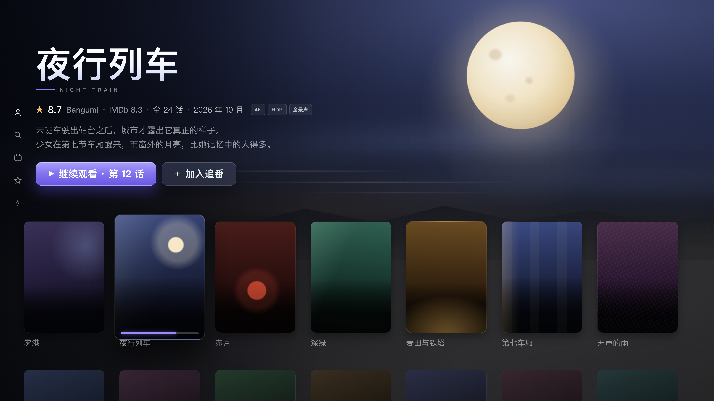

# Doki — 三端追番客户端实施方案

> **历史版本**：当前实施依据为 [v0.4](Doki-设计方案-v0.4.md)。用户最新要求采用独立 Apple 原生设计与 Liquid Glass，并将弹弹play弹幕纳入首版；本文件的旧视觉定位与范围不再生效。

> 版本 v0.3 · 2026-10-29 · 状态：实施基线，尚未进入代码实现。
> 平台：iPhone / Mac / Apple TV；最低系统暂定 iOS 26、macOS 26、tvOS 26，使用当前本机 Xcode 构建验证。
> 本文替代 v0.2 的实施决策。平台和上游接口结论附官方参考；真实源成功率、首帧速度、真机内存与工期均为待验证目标。
> 用户确认：以 izuko-tv 为主要界面与动效参考，在线源优先使用 MajoSissi/animeko-source。具体源码核对与接入要求见[参考实现与数据源接入](参考实现与数据源接入.md)。

## 0. 产品目标与决策

Doki 的首要体验是：找到正在追的番，播放正确的一集，在另一台设备继续，并正确更新 Bangumi 已看状态。

首版采用以下决策，后续按实际使用反馈调整：

| 项目 | 首版决定 |
|---|---|
| 使用者 | 单用户、多设备；表结构保留 `userId`，暂不开发家庭成员管理 |
| 分发 | 个人设备开发签名或具备相应资格的 Ad Hoc 安装；发布渠道单独验证 |
| 网络 | Apple TV 走家庭 LAN；外出的 iPhone/Mac 经已有 WireGuard 访问 Hub |
| 元数据 | Bangumi 为条目和章节基准；TMDB 作为可失败的图片增强 |
| 在线播放 | 适配指定 animeko-source 在线订阅快照，先启用其中 1～2 个验证通过的 provider，提供手动选择与修正 |
| 界面与动效 | izuko-tv 为主要参考；三端都完成原生界面，关键焦点/Hero/详情过渡纳入首版 |
| 播放器 | AVFoundation + AVKit 系统控件；优先原生字幕、画中画和 AirPlay |
| 编码 | 优先设备可原生播放的资源；允许按需重封装，首版不建设转码服务 |
| 交付顺序 | 先验证 Apple TV 播放；三端界面原型同时准备，关键动效随浏览页面交付，最后做真机性能打磨 |

**首版成功标准：三端稳定播放、正确续播、正确同步；背景图或自动匹配不可用时仍然能看。**

## 1. 范围与边界

### 1.1 首版必须交付

1. 三端原生入口、共享模型与网络层。
2. Hub 连接、设备配对、Bangumi OAuth 登录和退出。
3. 条目搜索、章节、收藏、本周新番、继续观看。
4. 基本 TMDB TV/movie 关联、图片回退与署名。
5. 指定在线订阅的快照导入、兼容性检查与源管理；其中 1～2 个 provider 的条目级搜索、剧集列表、按集解析。
6. direct/relay 播放、手动选源、受控失败切换。
7. 本地检查点、跨端续播、Bangumi 已看回写及同步失败恢复。
8. 基础字幕选择、音轨选择、原生全屏与平台支持的画中画。
9. Hub 备份、结构化诊断日志与明确的错误状态。
10. 三端首页、搜索、日历、收藏、详情/选集、播放器和设置；参考 izuko-tv 的焦点、Hero、背景切换和详情进出动效，逐端验收。

### 1.2 首版完成后再做

| 功能 | 启动条件 |
|---|---|
| 更多 provider / 其他订阅格式 | 指定快照的首批源已长期可用，兼容性测试集已经建立；不默认启用全部规则 |
| WebDAV / Jellyfin / Emby | 已出现稳定的自有库使用需求，并补齐凭据隔离与网络授权 |
| iPhone/Mac 离线下载 | 在线播放、签名续期和存储生命周期已验证；不承诺 tvOS 下载 |
| ASS 转基础字幕 | 出现实际样本需求，原生 VTT 路径保持可用 |
| 自动预告片、额外动效主题、条目取色、Top Shelf | 首版 izuko-tv 风格关键动效、基础焦点和播放体验已达标 |
| 多用户、公共发布版本 | 单独确定权限、账号、内容授权和分发要求 |

明确排除：BT/PT、磁力解析、RSS 磁力源、做种、弹幕、社交评论、DRM 绕过、ASS 烧录和视频重编码。IMDb/OMDb 评分不进入首版依赖。

### 1.3 尚需实测的假设

家宽上行、Ubuntu 硬件、真实源可用性、CDN 出口绑定、Apple TV 型号及签名安装条件尚未验证。进入 M0 时记录设备与网络清单；这些结果决定并发与画质上限，不能用固定“几路 4K”替代测量。

## 2. 架构与工程组织

### 2.1 数据流

```text
iPhone / Mac ── LAN 或已有 WireGuard ──┐
Apple TV ───────── LAN ───────────────┤
                                     ▼
                               Caddy / TLS
                                     │
                      Doki API（鉴权、查询、播放会话）
                         │          │           │
                     Postgres     Redis      媒体 relay
                         │          │           │
                         └──── Doki Worker ──────┘
                              受限出站网络
                               │       │
                        Bangumi/TMDB   源站/CDN
```

客户端保存离线可读的元数据和未确认事件；Hub 保存跨端状态、映射、外部服务凭据和任务。客户端不会执行源站脚本，也不会收到 Hub 持有的上游 Cookie。

网页 JS 解析放在 Worker，使 tvOS 无需 WebKit，并统一维护解析状态。纯 HTTP/JSON/HTML 解析优先使用轻量请求，只有已验证需要浏览器的源才启动 Playwright。Hub 不以“必能通过站点挑战”为能力承诺。

### 2.2 技术选择

| 层 | 方案 | 约束 |
|---|---|---|
| 客户端 | SwiftUI、多 app target、共享 Swift Packages | Swift 严格并发检查；平台导航和系统播放器容器分开 |
| 播放 | AVPlayer + AVKit | iOS/tvOS 用 AVPlayerViewController，macOS 用 AVPlayerView |
| 本地状态 | SwiftData + 图片磁盘缓存 | 未确认操作与可丢弃图片分开；tvOS 存储不可作为唯一副本 |
| API | TypeScript、Fastify、Zod | 同一份 schema 生成 OpenAPI；客户端用契约样本校验 |
| 数据库 | Postgres | 持久任务、进度、映射、同步游标与 outbox 的权威存储 |
| 后台任务 | Redis + BullMQ | 搜索、解析、预热；关键写回仍由持久 outbox 驱动 |
| 解析 | HTTP client + HTML parser；按需 Playwright | 每 provider 限并发和请求频率，浏览器隔离 |
| 媒体 | 流式 relay；按需 ffprobe/ffmpeg | 参数数组调用、超时及资源配额；只在确有必要时重封装 |
| 部署 | Docker Compose + Caddy | API、Worker 共用代码库，按进程职责部署 |

Node 选择实施时仍受支持的 LTS；Node、Playwright 浏览器、ffmpeg、数据库镜像固定版本或 digest 并记录。首版保持模块化单体，不拆微服务，不再增加 QuickJS 和第二套 provider 运行时。

### 2.3 目录

```text
Doki/
├─ README.md
├─ project.yml                   # XcodeGen；生成的工程不手工维护
├─ App/{iOS,macOS,tvOS,Shared}/
├─ Packages/
│  ├─ DokiCore/                  # 领域模型、API、本地状态、同步
│  ├─ DokiPlayback/              # 播放状态、平台适配、诊断
│  └─ DokiUI/                    # 语义颜色、卡片、货架和状态组件
├─ Server/
│  ├─ src/{api,domain,providers,media,jobs,integrations,db}/
│  ├─ test/fixtures/
│  └─ deploy/
└─ docs/
```

当前仓库只有设计资料；以上是后续工程目录，不表示已经实现。

## 3. 领域模型：稳定资源与临时播放分开

### 3.1 核心实体

| 实体 | 主键 / 关键字段 | 含义 |
|---|---|---|
| Subject | `bgmSubjectId` | Bangumi 条目，含类型、名称、别名、日期等 |
| Episode | `bgmEpisodeId`、`subjectId`、`kind`、`sort` | 章节身份使用 ID；显示集号不作为唯一键 |
| Provider | `providerId`、`implementationVersion` | 已接入的源及其能力、访问政策 |
| SourceSubject | `providerId + sourceSubjectKey` | 源站条目页，保存稳定定位信息 |
| SourceEpisode | `providerId + mediaId`、`sourceSubjectKey`、`channel` | 源站单集资源或线路；不以临时 CDN URL 作 ID |
| ResolvedAsset | `assetId`、`mediaId`、`expiresAt`、`networkBinding` | 某次解析结果，包含服务端请求上下文 |
| PlaybackSession | `sessionId`、`userId`、`deviceId`、`episodeId` | 本次观看，关联候选、切源、检查点与诊断 |

`SourceEpisode` 保存结构化季/集线索、原始标题、页面定位与解析器版本。带签名 URL、Cookie、UA 等放入短期 ResolvedAsset，默认不在客户端 API 或日志中暴露。

首版只播放已明确映射的单集 HLS/MP4。多集合集需要文件内条目或时间范围，单靠 `[1,12]` 不能定位第三集，因此暂不支持合集自动播放。

### 3.2 Provider 契约

```ts
interface MediaProvider {
  search(query: SubjectQuery, ctx: RequestContext): Promise<SourceSubject[]>;
  listEpisodes(subject: SourceSubject, ctx: RequestContext): Promise<SourceEpisode[]>;
  resolve(episode: SourceEpisode, ctx: ResolveContext): Promise<ResolvedAsset>;
}

interface SubjectQuery {
  bgmSubjectId: number;
  titles: string[];
  mediaKind: 'series' | 'movie' | 'special';
  year?: number;
  seasonHint?: number;
}

interface ResolvedAsset {
  assetId: string;
  mediaId: string;
  upstreamUrl: string;                 // 仅 Hub 内部
  requestContextRef?: string;           // Cookie/header 的隔离存储引用
  expiresAt?: string;                  // 未知表示需要保守复验，不表示永不过期
  networkBinding: 'none' | 'hubEgress' | 'unknown';
  deliveryOptions: Array<'direct' | 'relay' | 'remux'>;
}
```

按条目搜索与列出整季，按需解析当前集。浏览与自动匹配共用相同接口，手动路径始终存在。缓存只避免重复发现资源；真正的起播时间还取决于解析、过期复验、首个分片和解码。

参考 Animeko 的条目级查询和稳定资源身份，内部仍使用上述统一契约。首版增加 animeko-source 订阅适配器，把选定在线规则转换为内部 provider；其他订阅格式后续扩展。未通过格式语义、规则回放和真实播放测试的条目不能标为可用。

### 3.3 指定在线订阅的适配

首选输入：[MajoSissi/animeko-source 的 online.json](https://github.com/MajoSissi/animeko-source/blob/main/dist/online.json)。仅读取在线订阅，不读取 `all.json` 和 `bt.json`。

2026-10-29 核对的快照含 63 条规则，均为 `factoryId=web-selector`、`version=2`；入口为 `exportedMediaSourceDataList.mediaSources`，规则未提供源 `id`。这表示配置存在，不表示 63 个站点均可播放。

- 实现结构解码、默认值和明确的兼容性诊断；不支持的格式保留为 disabled，并显示原因。
- 根据真实配置实现搜索模板、CSS/JSONPath、线路/集号、嵌套播放页面、视频 URL 匹配、Cookie/Referer/UA、节流和线路排序；正则与选择器按上游语义逐项回放。
- 为无上游 ID 的条目维护内部稳定身份注册表；规则内容变动不直接改变源身份，名称或域名变化不能按数组下标误绑定。
- 初次固定快照和摘要，默认只启用少量待测候选。更新先比较差异和访问域名，规则改动通过验证后再生效；保留可回滚快照，不覆盖手动偏好。
- 适配器在 Hub/Worker 执行，浏览器和媒体请求仍受 §8 出站政策约束；客户端只拿到内部资源和播放会话。

详细字段、快照版本及验收步骤见[接入说明](参考实现与数据源接入.md)。

### 3.4 缓存与任务

| 内容 | 初始策略 | 失效条件 |
|---|---|---|
| 条目级源搜索 | 完结条目 6h；连载条目 30min | 用户刷新、provider 升级、负结果到期 |
| 已找到的线路/剧集页 | 独立于播放地址缓存 | 原页面变更、解析失败、人工修正 |
| ResolvedAsset | 尊重已知有效期并留安全余量；未知有效期短缓存 | 403/410、上下文或出口变化、显式刷新 |
| 下一集预解析 | 接近当前集结束时最多预热一集 | 离开播放、切换条目、队列拥堵时取消 |

同一用户、provider、资源、上下文的并发解析合并；失败只使受影响层失效。用户点击播放优先于搜索预热和图片增强，不把交互任务投到低优先级队列。

## 4. 条目与章节对齐

### 4.1 两种映射分别维护

1. **元数据映射**：Bangumi 条目/章节 ↔ TMDB TV season/episode 或 movie。
2. **播放映射**：Bangumi 章节 ↔ 某 provider 的 SourceEpisode。

两者独立：TMDB 匹配失败只影响图片，不阻止手动选源和播放；换播放源不会改变 Bangumi 章节身份。

### 4.2 显式映射与修订

| 表 | 必要字段 / 约束 |
|---|---|
| external_binding | `id, subjectId, provider, mediaType, externalId, season?, provenance, confidence, verified, revision`；同一条目允许多个外部绑定 |
| episode_external_mapping | `id, bgmEpisodeId, bindingId, externalEpisodeId?, season?, episode?, revision`；显式表达跨季和 SP |
| subject_source_binding | `id, userId, subjectId, providerId, sourceSubjectKey, verified, revision` |
| episode_source_mapping | `id, userId, bgmEpisodeId, sourceEpisodeId, confidence, verified, revision`；同集允许多线路 |

修订保存生成方式、算法/解析器版本、操作者和原值。人工确认结果不能被后台自动任务覆盖；原资源失效时提示重新选择。映射到其他 Bangumi 章节属于修正身份，不能静默搬运已有观看记录。

### 4.3 匹配策略

- 保留原始标题；归一化处理空格、全半角、可比较的繁简形式，同时把季、期、年份和 SP 标记提取为独立线索。
- 明确冲突的季度、作品形态作为拒绝条件，不靠标题高分抵消。
- TMDB 分开查询 TV/movie；`/find` 仅在已有外部 ID 时使用，不把其命中率当作标题搜索能力。
- 集号优先显式季集，其次明确集数文字；列表顺序只能作为低置信度建议。
- 不以一个拍定的加权分数直接开启全量自动绑定。先积累标注样本，再确定自动接受阈值；未达到阈值就让用户确认。
- 手动修正入口位于选集和源选择页面，Apple TV 可仅用遥控器完成。

初始样本至少覆盖 30 个条目，包括续作、分割放送、24 集跨季、SP/OVA、剧场版、不同译名。分别记录候选覆盖率、自动接受率和被接受结果的正确率，避免用“85% 对齐率”混合不同问题。

## 5. 播放闭环

### 5.1 创建播放会话

```text
点击某一集
  → POST /v1/playback/sessions（episodeId、deviceId、可选手动源、expectedResumeRevision）
  → 校验配对、章节身份、映射与续播版本
  → 命中有效解析结果：201 + PlaybackPlan
  → 需要解析：202 + sessionId + statusUrl + retryAfterMs
  → 客户端前台轮询会话；取消或离开后停止轮询
  → Worker 完成后 ready；失败返回可解释错误及手动选择入口
```

创建接口要求 `Idempotency-Key`，网络重试不能产生重复会话。会话是单集、单设备的观看实例，切下一集创建新会话；同一会话内切源不改变 Bangumi 章节。首版用有上限的轮询，暂不引入 SSE；服务端任务超时后必须结束状态。

### 5.2 客户端播放计划

```json
{
  "sessionId": "ps_example",
  "episodeId": 1024,
  "status": "ready",
  "resumeAtSeconds": 312.5,
  "resumeRevision": 18,
  "writeEpoch": 7,
  "source": {
    "sourceId": "se_example",
    "mode": "relay",
    "url": "https://hub.example.com/s/ps_example/manifest?exp=...&sig=...",
    "expiresAt": "2026-10-29T16:00:00Z"
  },
  "tracks": { "subtitleLanguages": ["zh-Hans"], "hasAlternateAudio": false },
  "capabilities": { "canSeek": true, "canAutoFailover": false }
}
```

返回当前选中的播放入口和可用能力，候选列表单独查询。计划声明与实际探测一致，不伪造画质、HDR、音轨或跨源时间轴兼容性。

### 5.3 播放状态与失败处理

```text
idle → locating → resolving → preparing → playing
                                 │          ├→ paused / seeking / buffering
                                 │          └→ ended
                                 └────────────→ recovering → preparing / failed
任一非结束状态 → cancelled（取消待办工作并清理 observer）
```

- `readyToPlay`、实际显示首帧与持续播放分别观测；首帧计时从点击开始，而不是从拿到 URL 开始。
- 先等待 item 可用、执行并等待 seek 完成，再播放；seek 位置限制在有效时长内。
- 所有换源、换集和关闭动作取消旧异步任务，旧回调携带 session/generation，避免恢复已经离开的播放器。
- 区分解析超时、鉴权失效、首帧缓慢和播放中卡顿。初始交互解析预算 15s、已取得资源后的首帧观察预算 8s，均为可调整默认值；不采用固定 2.5s 一律判死。
- 明确过期优先重新解析当前资源一次；其次尝试备选，自动恢复最多两次。用户手动取消立即停止。
- 只有已验证同一剪辑版本或时间轴偏移时才自动保留位置切源。不同片头、删减或合辑资源要求确认，从最近检查点附近恢复；不承诺无感切换。
- 暂停、seek 完成、退出及播放结束即时记录本地检查点；播放中每 5s 更新，正常每 15s 批量上报。系统强杀前的最后几秒允许丢失，已确认事件不可丢失。

### 5.4 direct / relay / remux

| 模式 | 使用条件 | 失败后的处理 |
|---|---|---|
| direct | 无私有 header 依赖、编码可用；客户端所在网络已实际验证 | 出口绑定未知时先验证；403 等失败后经 Hub 重新判断 relay |
| relay | 需要源站请求上下文、上游 IP 绑定 Hub，或必须改写 HLS | Hub 保留上游上下文，客户端只持会话入口 |
| remux | 原编码可解码、封装需转换，且 seek/音轨/字幕路径已验证 | 条件不满足则返回不支持或换源 |

服务器探测成功不等于外网客户端可 direct。初次接入默认保守选择 relay；客户端成功样本再建立按网络环境区分的 direct 能力缓存。

重封装不改变视频/音频编码，无法修复不支持的 codec。AC-3 本身属于 Apple HLS 支持的多声道编码，不能只因出现 AC-3 就判定不兼容。具体按设备、编码 profile、容器和音轨组合实测。[参考 S4]

remux 为可选能力：M0 若 direct/relay 足以支撑目标源，不实现它。若确需启用，必须验证首播、任意位置 seek、断点恢复、取消清理和磁盘上限；简单追加 EVENT 分片的命令不能直接当作完整 VOD 方案。

### 5.5 HLS relay 的最低契约

使用能解析 HLS 语义的处理方式，不能只用正则替换 `.ts` 后缀：

- 覆盖多码率与媒体 playlist、音轨/字幕 rendition、I-frame、KEY、MAP、相对 URI 与 query；保留源站签名参数。
- 正确处理 byte range、客户端 Range/If-Range、206/416、Content-Range、HEAD 和取消传播。
- 所有外部资源（含 key、字幕、重定向后的地址）走同一 provider 访问政策。
- 不支持的 LL-HLS、DRM 或特殊标签需明确拒绝或换源，不能静默产出损坏列表。
- 客户端只用服务端登记的 opaque resourceId；请求参数不能传任意上游 URL，也不能拼接任意相对路径。
- 签名覆盖 `sessionId + resourceId + exp + methodScope + tokenVersion`，验证会话所有者、授权设备/播放接收方及撤销状态。媒体 GET/HEAD 不同于管理 API 鉴权。
- URL 有效期、活动会话续期和已发出子资源 URL 的宽限期共同管理；正常完整一集和暂停恢复不能因固定短 TTL 中途失败。
- 播放接收方（如 AirPlay 设备）可能无法访问家庭域名；只能在接收方可达且权限成立时承诺 AirPlay。签名不能硬绑定手机源 IP。
- 流式转发、背压、断连取消、每源隔离连接池；初始限制 2 个活动播放会话，分片并发通过真机测量调整，不能按全部 HTTP 请求统一卡死。

### 5.6 字幕与系统能力

原生字幕优先：将 VTT 合入 HLS subtitle rendition，使用系统字幕和音轨选择。SRT 可转换为 UTF-8 VTT；ASS 后续仅转换对白，丢失排版/特效必须明确标注。暂不使用自绘 overlay 承担核心字幕。

| 平台 | 首版容器与操作 | 需要验证的能力 |
|---|---|---|
| iPhone | AVPlayerViewController、inline/全屏、系统操作 | 音频会话、后台恢复、PiP、锁屏元数据、AirPlay |
| Mac | AVPlayerView、空格播放、方向键 seek、全屏 | PiP、多窗口播放互斥、窗口关闭清理 |
| Apple TV | AVPlayerViewController、系统传输条、遥控器 | 焦点恢复、字幕、seek、PiP、内容匹配配置 |

tvOS 支持系统画中画，不能写为“不支持”；具体启动、恢复和前后台行为仍需真机验收。[参考 S3]

## 6. 观看状态与同步

### 6.1 权威与字段

| 状态 | 权威 | 说明 |
|---|---|---|
| 本机正在播放的位置 | 当前 AVPlayer + 本地持久检查点 | 网络不可用时仍即时更新 |
| 跨端续播位置 | Hub 接受的最新有效会话事件 | 按会话和版本裁决，不取最大 position |
| 最远观看位置 | Hub 按剪辑版本累计的 `furthestPosition` | 仅用于辅助统计，不用于强制 seek |
| 已看状态 | Hub 的有版本意图 + Bangumi 同步快照 | 区分本地待确认、上游已确认和冲突 |
| 收藏、评分、评论 | Bangumi 确认值 + Doki 待提交意图 | 读缓存可过期，UI 标出待同步 |

续播位置按 `(userId, bgmEpisodeId)` 保存当前会话、资源时间轴身份和 revision。不同源存在时间轴差异时记录源位置和经过验证的偏移，不能把任意源的秒数当作统一时间。

### 6.2 事件模型

```json
{
  "eventId": "uuid",
  "deviceId": "device_uuid",
  "sessionId": "ps_example",
  "deviceSeq": 42,
  "writeEpoch": 7,
  "baseRevision": 18,
  "episodeId": 1024,
  "kind": "seekCompleted",
  "positionSeconds": 305.5,
  "durationSeconds": 1440.0,
  "clientOccurredAt": "2026-10-29T14:00:00Z"
}
```

`eventId` 用于幂等，`deviceSeq` 在会话内递增；客户端时钟只做诊断，不作为全局排序依据。事件持久化、聚合状态变更、同步变更记录和必要 outbox 写入放在同一数据库事务中。

### 6.3 冲突规则

1. 新会话取得该集的写入 epoch，并检查客户端见到的 resume revision。另一设备仍活跃或 revision 已改变时返回冲突，展示“继续这台设备 / 使用同步进度”，不能静默抢占。
2. 正常切换到另一台设备时，用户确认从同步位置继续，Hub 在事务中提升 epoch；旧设备此后只能保存自己的检查点，不能推进全局续播位置。
3. 同一有效 epoch 按 `deviceSeq` 接受新事件。旧序号或重复事件不再改变状态；seek 回退合法，即使位置变小也更新续播。
4. 离线产生的旧 epoch 事件重连后可保存为设备检查点，但不覆盖较新的全局会话。离线新会话先是本地 provisional 会话，重连时携带原 revision，冲突就让用户选择。
5. 手动重看、取消已看、重置进度提升对应状态版本，并使旧自动完成事件失效；旧设备重试不能把取消操作改回已看。
6. 同源重新播放会话可以继承检查点；换源只有时间轴已验证才自动继承秒数，其他情况请求确认。

首版按“单用户同一集一个有效写入会话”实现，不建设复杂的同时观看合并算法。用户仍可在旧设备播放，但界面明确其检查点当前未成为跨端续播位置。

### 6.4 自动已看

默认开启，可关闭。时长未知时不自动标记；用户主动操作始终优先。已确认的正常播完可触发自动已看；仅拖动到 90% 不触发。

客户端用连续播放区间合并统计有效观看覆盖，seek 跨越的区间不计入。初始自动判定要求非 seek 的自然播放达到全片 90% 之后，并且有效观看覆盖达到 80%；阈值作为产品策略单独测试。自然播放到结尾同样需要足够覆盖，避免一次跳到尾部误标。退出时丢失几个采样点不能改变明确的手动状态。

### 6.5 Outbox 与 Bangumi 外部修改

- 写入键是 `(userId, entityType, entityId, fieldGroup)`；记录单调 `intentRevision` 和期望的最终状态，不用永久的 `user+ep+type` 去重键。
- 同一键按序执行，只允许一个在途请求。发送前重查当前意图；过期任务跳过，防止旧“已看”重试覆盖新的“未看”。
- 网络结果不明时重试设置型操作，但仍在同一键串行处理；不能让新旧 HTTP 请求并行覆盖。429 遵守 Retry-After，其他暂时错误退避并加抖动。
- 401 只触发一次串行 token 刷新再试；授权失效则暂停写回并提示重新登录，不无限重试。
- 达到失败阈值进入可恢复失败状态，保留意图和错误；用户可重试或丢弃，不能标为同步成功。
- 拉取 Bangumi 状态时，无本地待提交意图就接受上游变化；有待提交意图且与上次确认值冲突时，暂停该实体写回并提示保留哪一边。
- 外部接口未提供同等的版本条件写入保障，因此并发从 Bangumi 网站修改无法保证完全无冲突；在启动/前台恢复及写后复读时做对账，并明确该边界。
- 评分和评论仅由显式操作产生；首版不开发评论编辑。跨域镜像只用于配置允许的读取，不自动跨域重放写入或 token。

### 6.6 增量同步游标

`GET /v1/sync?cursor=...` 返回有上限的分页变更、删除 tombstone 和不透明游标。按用户隔离；初始快照与增量使用一致的水位。

不能只用并发事务里的数据库 sequence 充当“已提交先后顺序”：同一用户的状态写入通过锁定 `user_sync_clock` 行串行分配 revision，再在同一事务写入变更，避免晚提交的小序号被客户端跳过。游标过期返回 `SYNC_RESET_REQUIRED`，客户端重新取快照，但保留未确认本地事件。

## 7. 元数据、登录与设备配对

### 7.1 Bangumi

Hub 统一处理 OAuth 换取与刷新 token。`client_secret` 留在服务器，token 加密入库；refresh token 更新按账号串行执行并原子保存。过期时间以响应为准，提前刷新；不把“定时刷新”作为唯一恢复机制。[参考 S1]、[参考 S2]

登录流程：

1. 已登记设备向 Hub 创建一次性 OAuth transaction；绑定随机 state、发起设备和短期完成凭证。
2. iPhone/Mac 用 ASWebAuthenticationSession 打开授权页面。注册回调为用户设备可经 LAN/VPN 访问的 Hub HTTPS 回调；回调由用户代理访问，不要求 Hub 的 API 向公网开放。
3. Hub 验证 state、transaction 生命周期和设备绑定，收到 code 后及时换取 token。
4. 回到 App 的链接只用于唤醒和标识 transaction；App 带原始完成凭证向 Hub 查询结果，不在自定义 scheme URL 中传 access token 或长期设备 token。
5. Apple TV 通过已配对手机完成同一 Hub 用户的授权，不把设备配对码当作 Bangumi 提供的 OAuth device grant。

回调可达性、Bangumi 应用注册地址和 ASWebAuthenticationSession 的完成回调属于 M0/M1 实测项。Hub 失联时保留缓存和待确认操作，明确提示授权尚未完成。

已核对的写入契约：

```http
PUT /v0/users/-/collections/-/episodes/{episode_id}
Content-Type: application/json

{"type": 2}
```

```http
PATCH /v0/users/-/collections/{subject_id}/episodes
Content-Type: application/json

{"episode_id": [1, 2, 8], "type": 2}
```

批量接口的 `episode_id` 是数组，不是 `{episodeId: type}` 映射。收藏字段和章节状态枚举都从上游 OpenAPI 校验，不把内部枚举序号直接透传。[参考 S1]

### 7.2 元数据可用性

| 内容 | 初始 TTL | 失败行为 |
|---|---|---|
| Bangumi 条目 | 7d | 展示旧值并后台重验证 |
| 章节 | 连载 6h / 完结 1d | 保留已有列表，支持显式刷新 |
| 日历 | 6h | 展示缓存日期，避免伪装为实时 |
| 用户收藏 | 5min | 保留已确认值和待提交意图 |
| 搜索 | 5min；负结果更短 | 明确无结果/网络失败，不能混为同一缓存 |

识别性 User-Agent，客户端请求合并，服务端初始保守限速并按实际响应调整；429/5xx 退避。缓存 raw 响应仅用于必要的元数据回放，有保留期限；不记录包含授权信息的完整响应或请求。

TMDB 图片是可选增强：匹配失败用 Bangumi 海报与纯文字标题；没有 Logo 时保留原生文字，没有横幅时用稳定底色，不对整张海报做高成本模糊。图片按展示尺寸请求，Hero 不默认下载 original。

非商业 TMDB API 使用需按官方要求署名，关于页包含批准的 TMDB 标识和指定声明；未来商业化另行核对使用许可。[参考 S5]

### 7.3 Hub 身份与配对

- 首次所有者通过服务器本地生成的一次性 setup secret 登记，不能采用“首个访问者自动成为管理员”。开发阶段也不把测试 token 硬编码在 App。
- Apple TV 创建短期配对请求，显示 QR 和六位确认码；已授权设备显示目标设备名称并确认。
- 六位码只定位待批准请求，不独立授予访问权限；领取 token 还需电视持有的高熵秘密。配对短期过期，限制尝试次数，批准/领取均只能执行一次。
- 长期设备 token 可撤销、服务端只存摘要，客户端放 Keychain；token 生命周期和续期由 Hub 管理，不能硬编码为永不过期。
- 每个设备只访问同一 Hub 用户的数据；退出 Bangumi 授权与撤销设备是两个显式动作。解绑 Bangumi 会暂停未完成回写并提示处理，不能清除失败证据。

## 8. 网络、部署与安全边界

### 8.1 家庭访问

首版保留家庭 Hub，不新增 VPS 媒体中转。外出的设备需先连接已有 WireGuard；Hub API/媒体端口只允许 LAN/VPN 访问。WireGuard 自身 UDP 入口可能需要公网或路由器端口映射，因此不宣称“整套系统没有公网端口”。

推荐使用自有域名和 DNS-01 签发受信任证书；LAN 与 VPN DNS 将同一 Hub 域名解析到各自可达地址。DNS 服务、VPN 回程路由、重叠家庭网段、IPv6 和证书续期都列入部署验收。不要把仅 VPN 可达的 `10.x` 地址直接当作 Apple TV 的唯一地址。

只将实际家庭/VPN 子网加入 AllowedIPs；不在模板中假定所有家庭都用同一个 `192.168.1.0/24`。DNS-01 需要相应 Caddy DNS provider 模块；采用固定构建和最小权限 DNS 凭据。Caddy 内置 CA 是开发备选，三端信任部署验证后才可使用。

Docker 端口仅绑定需要的主机地址，并验证 IPv4/IPv6 和 Docker 防火墙行为；数据库、Redis、Worker 不发布到主机公网端口。Caddy 负责 TLS 和反向代理，API 自己执行管理接口限流，不假定标准 Caddy 自带 rate-limit 指令。

### 8.2 Provider 的出站控制

源站与订阅都按不可信输入处理。它们可能要求 Hub 访问任意 URL，而 Hub 位于家庭内网：

- 网络出口集中执行策略，对 HTTP、浏览器导航及子资源、WebSocket、媒体分片/密钥、图片、ffmpeg 请求一致生效。
- 默认只允许 HTTP(S) 与已批准域名/端口，阻止 loopback、私网、链路本地、云元数据及相关 IPv6/映射地址；每次 DNS 解析、连接和重定向后重新检查，防止重绑定和绕过。
- 使用强制出站代理/网络隔离约束浏览器与 ffmpeg；不能只检查最初传入的页面 URL。Worker 本身需要的 PG/Redis 访问和不可信浏览器网络分开。
- 自有库后续采用单独的地址、路径和凭据授权，只能访问明确批准的目标，不放开整个 LAN。
- Cookie/Authorization 只送往其允许的 origin，跨域重定向或 CDN 跳转不能盲目复制全部请求头。
- 禁止 `file:` 等本地协议、任意文件路径和 shell 字符串调用；执行子进程用固定程序和参数数组，并限制协议、运行时间、并发、CPU、内存和输出尺寸。
- Worker 以非 root 身份运行、无 Docker socket、只读基础文件系统，临时目录定额；只有明确需要的共享目录可写。

### 8.3 数据与运维

Bangumi token、provider 凭据与流签名密钥分离管理。数据库备份配合密钥恢复方案；加密数据与其唯一解密密钥不能只存于同一份备份。日志脱敏 Cookie、Authorization、OAuth code 和带签名 query。

Postgres 为权威状态，Redis 丢失后可从持久任务和过期会话重建，不丢已确认进度与 outbox。API readiness 检查迁移和依赖；Worker 有心跳与超时任务回收。升级执行受控迁移，保留上一镜像与升级前备份，定期实际恢复一份备份验证。

## 9. API 与存储契约

### 9.1 API

JSON 使用 camelCase；时间为 UTC ISO8601；播放位置使用秒的浮点数。统一错误体：`{code, message, retryable, requestId, details?}`。`details` 只含可安全展示的上下文。

| 方法 | 路径 | 语义 |
|---|---|---|
| GET | `/v1/bootstrap` | Hub 版本、协议版本、能力和连接状态 |
| POST | `/v1/setup/claim` | 使用一次性本地 setup secret 登记所有者 |
| POST | `/v1/devices/pairings` | 创建短期配对请求 |
| GET | `/v1/devices/pairings/{id}` | 查看当前设备凭秘密可查询的配对状态 |
| POST | `/v1/devices/pairings/{id}/approve` | 已授权设备确认配对 |
| POST | `/v1/devices/pairings/{id}/claim` | 新设备持秘密领取 token |
| DELETE | `/v1/devices/{id}` | 撤销设备及其会话 |
| POST / GET | `/v1/auth/bgm/transactions`、`/{id}` | 发起授权、查询绑定的 transaction |
| GET | `/v1/auth/bgm/callback` | OAuth HTTPS 回调；仅按一次性 transaction 处理 |
| DELETE | `/v1/auth/bgm` | 解除 Bangumi 授权并暂停写回 |
| GET | `/v1/home`、`/v1/calendar` | 带缓存版本和更新时间的内容 |
| GET | `/v1/subjects/{id}`、`/{id}/episodes` | 聚合条目与章节，支持分页 |
| POST | `/v1/search` | 元数据搜索，不自动触发所有源解析 |
| POST | `/v1/source-searches` | 创建或复用条目级源搜索任务 |
| GET | `/v1/source-searches/{id}` | 查询候选和任务结果 |
| GET | `/v1/subjects/{id}/source-candidates` | 缓存的源条目、线路与映射建议 |
| PUT | `/v1/episodes/{id}/source-mappings/{sourceEpisodeId}` | 确认或修正映射，带 expected revision |
| PUT | `/v1/subjects/{id}/external-bindings/{bindingId}` | 确认 TMDB 候选；客户端生成 bindingId，带版本 |
| POST / GET | `/v1/playback/sessions`、`/{id}` | 创建会话、查询状态/计划 |
| POST | `/v1/playback/sessions/{id}/takeover` | 确认新的写入 epoch，带 expected revision |
| POST | `/v1/playback/sessions/{id}/source` | 请求切源或重新解析 |
| DELETE | `/v1/playback/sessions/{id}` | 关闭会话与解析任务；保留观看检查点 |
| POST | `/v1/progress/events` | 批量幂等事件；逐条返回 accepted/duplicate/conflict |
| PUT | `/v1/episodes/{id}/watch-state` | 显式已看、未看或重看意图，带版本 |
| PATCH | `/v1/subjects/{id}/collection` | 收藏/评分显式变更，带版本 |
| GET | `/v1/sync?cursor=...` | 用户隔离的分页增量及 tombstone |
| GET | `/v1/sync/issues` | 冲突、授权过期和失败写回 |
| POST | `/v1/sync/issues/{id}/resolve` | 选择保留状态、重试或丢弃 |
| GET / HEAD | `/s/{sessionId}/{resourceId}` | 签名媒体资源；独立流量和并发限制 |

创建/确认/切源/进度提交等可重试写请求均需幂等约束。202 返回状态 URL；409 返回最新 revision 和恢复选项；凭据不足、网络不可达、没有片源和上游暂时故障分别编码。读取接口不隐式创建 ffmpeg 或浏览器任务。

### 9.2 最小持久表

| 分组 | 表与关键要求 |
|---|---|
| 身份 | `user, device, pairing, oauth_transaction, oauth_credential`；设备撤销、一次性凭证与过期索引 |
| 元数据 | `subject, episode, external_binding, episode_external_mapping`；外键与修订来源 |
| 源 | `provider, source_subject, source_episode, subject_source_binding, episode_source_mapping`；稳定复合唯一键 |
| 播放 | `playback_session, progress_event, device_checkpoint, episode_progress`；事件 UUID 唯一，session/seq 唯一 |
| 观看/收藏 | `watch_state, collection_intent, upstream_snapshot`；期望值、确认值与 revision 分开 |
| 同步 | `user_sync_clock, sync_change, outbox, sync_issue`；事务水位、tombstone、串行 intent key |
| 运维 | `job, provider_health`；持久任务引用和状态，不存敏感完整 URL 到健康记录 |

ResolvedAsset 和媒体资源映射是短期状态，默认 Redis 加 TTL；会话保留稳定资源引用以便重建。原始事件和已完成 outbox 制定保留期后归档，不无限增长。

先以这些实体生成真实迁移和约束，再用事务/并发测试验证；本方案不把省略关键约束的 SQL 草图当成生产 schema。

## 10. 三端界面

### 10.1 共享视觉原则

以用户指定的 izuko-tv 作为主要视觉与动效参考，保留全出血背景、清晰主操作、横向货架、分段 Hero 和可逆详情过渡。系统导航与播放器控件结合平台操作方式适配；Liquid Glass 只用于适合的导航/操作层。正文、海报、章节行保持清楚且可读。关键动效是首版交付内容，不再统一推迟为静态背景。



上图是已有的概念效果图，仍保留早期评分、徽章和图标导航示意；不代表 v0.3 的完整功能或真实播放能力，也不是性能验证结果。实施时按下表调整：

| 项目 | 实施要求 |
|---|---|
| 主操作 | 优先“继续观看 / 播放第 N 集”，文字来自真实章节和已确认检查点 |
| 侧栏 | 收起可用图标；聚焦/展开显示文字，所有入口有辅助功能标签 |
| Hero | 参考 izuko-tv 分离底色、背景、文字和货架的过渡；保留上一张成功图片直到新图可用，加载失败不闪空 |
| 缺图 | 缺横幅用稳定底色，缺 Logo 用正文标题，缺海报保留固定尺寸和条目名 |
| 能力徽章 | 4K/HDR/音轨等来自选中资源探测；未探测不显示能力保证 |
| 焦点 | 参考 izuko-tv 的缩放、抬升、文字亮度和过渡保持；与系统效果协调，避免重复放大，保证复杂海报上仍可识别 |
| 色彩 | 语义颜色，分别检查浅/深色对比；条目取色后置，并做对比度校验 |
| 动效 | 保留焦点、背景换图、Hero 和详情进出；立即响应输入，视觉过渡有上限且可取消，不等待网络图片才导航；支持减少动态效果与减少透明度 |
| 内容 | 简介、日期、评分、来源和失败提示保留；避免重复引导文案占据首屏 |

参考项目的 dp、sp 和 tvOS pt 不按固定乘数自动转换。首轮 tvOS 卡片宽度可从约 220pt 开始，在真机观看距离、字体、焦点放大裁剪和安全区域上调整；不把参考数值或黄金比例透明度设为硬规范。

### 10.2 导航与操作

| 平台 | 页面结构 | 首版重点 |
|---|---|---|
| iPhone | 原生 TabView：首页 / 日历 / 搜索 / 我的 | 单手选集、明确横竖屏、收藏与源入口易找 |
| Mac | NavigationSplitView：侧栏 + 内容；详情自适应 | 键盘快捷键、窗口缩放、无悬浮大面板遮挡内容 |
| Apple TV | 可展开侧栏 + Hero/货架 + 详情/选集 + 系统播放器 | 遥控器可完成选择、修正、重试和返回 |

核心业务共享，平台导航和卡片密度独立。Mac 首版使用单播放窗口策略，避免多个窗口争抢同一播放会话；多窗口浏览后置。iPhone/TV 的容器代码不能直接套在 Mac 上。

### 10.3 tvOS 焦点

焦点状态用稳定条目/章节 ID，不能绑定列表下标。记录“哪个货架、哪个条目”，返回时恢复；异步换图、分页加载、源搜索结果追加不得抢走焦点。

先用 SwiftUI 实现；将卡片呈现与焦点/滚动适配分开。300 张卡片、长按方向键、快速上下切行出现实测问题后，针对具体列表评估 UICollectionView。Android TV 的实现选择不作为 tvOS 必须更换框架的证据。

无背景图、文字过长、空收藏、没有片源、Hub 断开、同步失败都必须有可操作状态。首版包含可中断、可逆的 Hero 与详情过渡；自动预告片和整排自定义播放器控件后置。

### 10.4 izuko-tv 动效交付清单

| 动效 | 首版要求 | 验收重点 |
|---|---|---|
| 卡片焦点 | 聚焦缩放/抬升、文字亮度变化；失焦可反向过渡 | 连续导航不跳动，系统效果不重复叠加 |
| Hero | 货架弱化、底色过渡、背景呈现、文字分段进入 | 快速切换取消过时任务，文字和背景始终对应同一条目 |
| 背景换图 | 旧图保持、新图淡入与清晰度升级 | 图片晚到不闪黑、不把新背景换回旧条目 |
| 详情进出 | 卡片/背景/标题在浏览页与详情页之间连续交接 | 转场中可取消，返回保持原卡片焦点外观和滚动位置 |
| 侧栏 | 焦点进入展开、文字和羽化底衬过渡 | 退出恢复原内容位置，浅/深色一致 |
| 三端改编 | TV 遥控器、iPhone 触控、Mac 鼠标/键盘分别触发 | 保留同一视觉语言，不把 TV 的悬停焦点行为机械套到触屏 |

先以[源码核对记录](参考实现与数据源接入.md)里的时序作原型起点，再用真机录屏评估。减少动态效果时提供较短淡入或直接切换；缺少目标图片时采用有上限的降级，不依赖无限等待完成转场。

### 10.5 缓存与断网体验

启动先展示本地已成功加载的首页和继续观看；后台刷新不清空旧内容。内存图片按实际像素降采样和字节成本淘汰，缓存容量以真机测量调整。

本地未确认事件、设备身份与元数据缓存分开管理，清理图片不能删除进度。tvOS 缓存可能被系统清理，首次启动或缓存丢失必须能从 Hub 重建；不承诺不可恢复的离线观看记录。

连接状态表示为 `reachable / reconnecting / unavailable` 并附实际访问路径诊断，不能只根据 Wi-Fi 或 VPN 图标推断 Hub 可达。Hub 不可达时展示缓存、重试和家庭网络说明；不会自动尝试所有源或产生一屏错误弹窗。只有验证 WireGuard 的公开跳转能力后才加入快捷跳转，首版不依赖深链唤起它。

## 11. 里程碑与退出条件

下列时间是单人全职的规划区间，不是已验证工期；真实源、设备安装或网络前提失败时先调整方案。M0 结束后根据测量结果重新估算。可复用的代码或 Agent 辅助不替代设备验收。

| 阶段 | 目标 / 内容 | 规划 | 必须通过的退出条件 |
|---|---|---|---|
| M0 播放验证 | 三端最小 target、最小 Hub；指定在线订阅的解码/身份注册；固定条目/映射；一个真实源的 direct/relay；临时开发设备凭据；验证浏览器访问隔离 | 约 1～2 周 | 订阅结构可导入、未知规则不误启用；Apple TV 真机完整播放一集，首/中/尾 seek、暂停恢复和重开续播；iPhone/Mac 同样本出画；记录 codec、字幕、网络、错误；受限 Worker 能实际解析目标源 |
| M1 账号与同步 | 安全配对、Bangumi OAuth、事件、写入 epoch、outbox、失败恢复；用基础详情承载 | 约 2 周 | 三端切换续播；回看不被推进；旧会话补报不覆盖；已看/取消已看正确；撤销设备后失去访问 |
| M2 浏览与动效 | 三端搜索、收藏、日历、首页与详情；TMDB TV/movie；显式映射；izuko-tv 风格焦点、Hero、背景换图和详情进出 | 约 2～3 周 | 三端完整界面与动效原型可录屏验收；无 TMDB/缺图仍可用；快速取消不串条目；同名续作/SP/剧场版可人工纠正 |
| M3 第二个源与恢复 | 第二个独立 provider；查询/解析缓存；过期复验、选源、受控切换；原生字幕 | 约 1～2 周 | 两个源各有真实样本；资源过期可恢复；不同时间轴不静默跳转；Redis 重启后不丢确认状态 |
| M4 三端验收 | 焦点、浅/深色、后台/前台、系统能力、网络降级、安装和备份恢复 | 约 2 周 | 首版验收矩阵通过，残余限制逐项记录；三端真机安装流程可重复 |

按指定订阅适配和关键动效的新范围，首版规划约 9～12 周，再预留 1～2 周处理源站、系统和部署差异；M0 后重估。三端界面与动效原型可独立于真实播放验证推进，生产集成仍按里程碑验收。未通过 M0 不批量扩源；不能因为先验证播放而把用户明确要求的动效全部删去。缺少 Apple TV 真机时只能交付模拟器阶段结果，不能宣称三端真机完成。

开发可以在某一端先完成链路，但每个涉及共享业务的里程碑都验证三端；不把 iPhone/Mac 的集成推迟到最后一次性补做。

### 11.1 M0 当天的具体工作

1. 记录 Apple TV/iPhone/Mac 型号、系统、Xcode/SDK、开发者签名条件和 Ubuntu 网络信息。
2. 固定指定 online.json 的版本，从中筛选候选与明确允许用于测试的样本，记录页面、编码/封装、字幕、有效期和 header 需求；敏感地址放本地配置。
3. 验证家庭域名在 LAN 与 VPN 的解析、证书、Hub 访问和必要的媒体吞吐。
4. 建立单源 `search/listEpisodes/resolve` 的最小实现，先手动绑定，验证 direct 与 relay。
5. 用系统播放器跑通真机播放、seek、关闭与重新打开；记录日志与截图。
6. 给出继续/更换源/调整能力的结论，再进入账号与完整同步实现。

## 12. 验证与观测

### 12.1 测试分层

| 层级 | 必测内容 |
|---|---|
| 领域与事务 | 事件去重/乱序、epoch 抢占、主动回退、重看重置、旧自动已看、outbox 串行、并发提交水位与游标分页 |
| 上游契约 | Bangumi 单集/批量请求体、OAuth 错误恢复、TMDB TV/movie、分页与缺字段 |
| Provider 回放 | 指定订阅的解码、无 ID 身份保持、选择器/正则语义、更新回滚；脱敏 HTML/JSON、线路变化、缺集、不同季度和解析过期 |
| 媒体协议 | 多码率、独立音轨/VTT、AES-128 KEY、MAP、相对 URI/query、Range、重定向、取消、撤销和过期 |
| 安全边界 | 私网/IPv6/重绑定/重定向、浏览器子资源、跨域凭据、未知 resourceId、配对暴力尝试与重放 |
| 三端交互 | 播放/seek/退出/续播、选源修正、同步问题处理、浅深色、长标题与缺图 |
| tvOS 专项 | 300 张卡片、长按方向键、跨行、从详情/播放器返回、图片晚到、失焦恢复；Hero 反向中断、标题交接、返回卡片保持放大 |
| 部署恢复 | Redis 丢失、Worker 超时重启、数据库恢复、证书续期、设备撤销、LAN/VPN 切换 |

Fixture 测试验证已录制协议，不证明源站当前可用；另做少量真实源验收并标注时间、设备和网络，外部站点不稳定不作为普通单元测试的随机失败源。

### 12.2 首版真机验收矩阵

| 场景 | iPhone | Mac | Apple TV |
|---|---|---|---|
| 同一集起播、seek、暂停恢复、结束 | 必须 | 必须 | 必须 |
| 正常退出与重新进入续播 | 必须 | 必须 | 必须 |
| 从其他设备续播与主动回看 | 必须 | 必须 | 必须 |
| 手动选源/修正章节、失败后重试 | 必须 | 必须 | 仅遥控器完成 |
| 字幕/音轨、PiP 进入与恢复 | 支持的设备必测 | 支持的设备必测 | 支持的设备必测 |
| AirPlay | 发送/恢复与接收方可达性 | 支持的路径验证 | 按实际场景验证 |
| 外网 WireGuard | 必须 | 必须 | 首版按 LAN 验收 |
| Hub 断开、凭据过期、缺图 | 必须 | 必须 | 必须 |

### 12.3 性能目标与统计口径

以下为初始目标，须记录基线和设备，M0/M4 后据实修订。单一最快样本不代表达标。

| 指标 | 初始目标 / 口径 |
|---|---|
| 缓存首页可交互 | 目标约 1.5s 内；不等待图片或 TMDB 成功 |
| 有效解析结果命中的首帧 | 目标 p50 ≤ 3s、p95 ≤ 8s；从点击到实际出画 |
| 冷搜索/浏览器解析首帧 | 单独统计，不与缓存命中混算；15s 解析预算后提供恢复操作 |
| 播放可靠性 | 记录完整集播放次数、卡顿时长、失败原因和恢复结果；首批小样本不宣称失败率 <5% |
| 货架交互 | 目标流畅 60fps；记录实际掉帧、输入延迟和峰值内存 |
| 媒体带宽 | 在已测上行扣除其他流量和协议余量后限并发；4K 仅在实测资源与设备允许时开放 |

日志统一携带 request/session/provider/resource/episode ID，阶段计时区分源搜索、解析、首个媒体响应、解码出画和恢复；不在日志里打印可复用的流链接或凭据。

## 13. 分发与参考项目

首版按个人使用设计，先跑通三端安装、重签与更新。具体 profile 和有效期以实际账号与签名结果为准；不把固定“7 天/1 年”当作所有渠道通用规则。

TestFlight 同样受 App Review Guidelines 约束，不作为绕过审核的自用通道。未来公开分发时再确认内容授权、第三方服务条款、隐私说明和后端审核可达性；“用户自填源”也不是自动通过审核的保证。[参考 S6]

Provider 抽象从第一天存在，但首版不维护两套产品和两套 build configuration。未来公开版可通过明确的 capability 配置和内容政策限制 provider，而不是预先开发一套没有验证需求的发布分支。

Animeko 与 izuko-tv 用于理解条目级查询、稳定资源身份、手动浏览和 TV 交互。保留参考出处；引入代码、订阅、素材或依赖前逐项核对对应版本和文件的许可证，记录使用方式与义务。首版独立实现，不把“改写变量名”视为规避许可证的方法，也不把“AGPL 一行都不能用”或“布局数值全部可自由复制”当作法律结论。[参考 S7]

主要参考分工明确为：izuko-tv 负责界面与动效目标，Animeko 负责源执行与资源身份语义，MajoSissi/animeko-source 提供首选在线规则集合。后者是第三方规则聚合库，本次根目录未见 LICENSE，不能把其他参考项目的 AGPL 自动套用到它；公开打包/再分发前记录具体规则来源和授权情况。当前继续推进本地格式适配与验证设计。[参考 S8]

## 14. 相对 v0.2 的主要变更

| 原方向 | v0.3 决策 |
|---|---|
| 首页与元数据完成后才验证播放 | M0 就验证 Apple TV 真实播放、seek 与恢复 |
| 首版包含离线、ASS、自绘字幕、双轨发布 | 首版聚焦在线播放、续播和同步，其他后置 |
| 资源身份和临时播放 URL 混合 | SourceEpisode / ResolvedAsset / PlaybackSession 分层 |
| 单个 season/offset/rule 表达全部映射 | 显式章节映射、多绑定、修订与人工确认优先 |
| 按最大 position 合并进度 | 有版本的会话事件、写入 epoch、检查点和冲突处理 |
| user+ep+type 作为长期写回去重键 | 有版本的最终意图、按实体串行 outbox |
| 2.5s 固定换源、跨源无感恢复 | 分阶段预算，有限恢复，时间轴兼容后才能自动继承位置 |
| AC-3 视为统一不兼容、remux 当作万能兜底 | 按实际 codec/container/device 探测；重封装不改编码 |
| tvOS 不支持 PiP、TestFlight 可作自用退路 | 修正平台能力和分发约束 |
| 订阅文件直接兼容、增加 QuickJS | 首版适配指定 online.json 的可验证规则，使用统一 provider 契约；不支持的格式明确禁用 |
| 固定倍数照搬 TV 尺寸、预判必换 UIKit | 原生组件起步，布局与框架选择由真机结果决定 |
| 内网可省去主要鉴权防护 | 保留设备权限、撤销、媒体签名和不可信源出站隔离 |

## 附录：参考与证据边界

查阅日期：2026-10-29。接口与平台文档用于约束设计；源站、账号授权、家庭网络、完整三端行为仍需按里程碑实测。

- **S1**：[Bangumi OpenAPI dist.json](https://bangumi.github.io/api/dist.json)，本次读取的 schema 版本为 `2026-07-24`；实施时锁定契约样本并复核。
- **S2**：[Bangumi OAuth 文档](https://github.com/bangumi/api/blob/master/docs-raw/How-to-Auth.md)，授权 code、token 换取与刷新流程。
- **S3**：[Apple：tvOS 画中画](https://developer.apple.com/documentation/avkit/adopting-picture-in-picture-playback-in-tvos)；本机 tvOS 27.0 SDK 的 AVPlayerViewController.h 也声明 `allowsPictureInPicturePlayback` 从 tvOS 14 可用。
- **S4**：[Apple HLS Authoring Specification](https://developer.apple.com/streaming/hls-authoring-specification-for-apple-devices.html)，编码、容器、音轨、字幕与传输约束。
- **S5**：[TMDB FAQ](https://developer.themoviedb.org/docs/faq)，非商业使用、商业许可与署名要求。
- **S6**：[App Review Guidelines](https://developer.apple.com/app-store/review/guidelines/)，重点核对 §2.2、§5.2.2、§5.2.3。
- **S7**：[Animeko MediaSource](https://github.com/open-ani/animeko/blob/main/docs/contributing/code/media/media-source.md)、[izuko-tv](https://github.com/GrahamZen/izuko-tv)、[animeko-subs](https://github.com/creamycake-anime/animeko-subs)，作为架构与兼容性调查对象，不表示已有代码复用或订阅兼容。
- **S8**：[MajoSissi/animeko-source](https://github.com/MajoSissi/animeko-source)，用户指定的在线订阅集合；当次版本、字段和已读源码清单见[参考实现与数据源接入](参考实现与数据源接入.md)。

[参考 S1]: https://bangumi.github.io/api/dist.json
[参考 S2]: https://github.com/bangumi/api/blob/master/docs-raw/How-to-Auth.md
[参考 S3]: https://developer.apple.com/documentation/avkit/adopting-picture-in-picture-playback-in-tvos
[参考 S4]: https://developer.apple.com/streaming/hls-authoring-specification-for-apple-devices.html
[参考 S5]: https://developer.themoviedb.org/docs/faq
[参考 S6]: https://developer.apple.com/app-store/review/guidelines/
[参考 S7]: https://github.com/open-ani/animeko/blob/main/docs/contributing/code/media/media-source.md
[参考 S8]: https://github.com/MajoSissi/animeko-source
